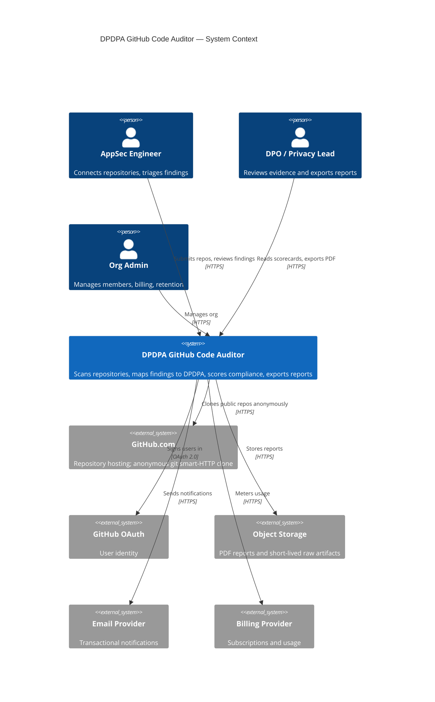
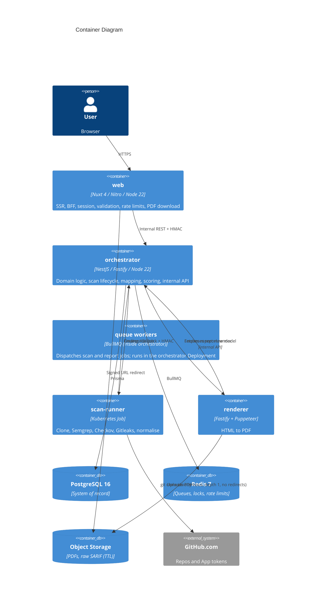
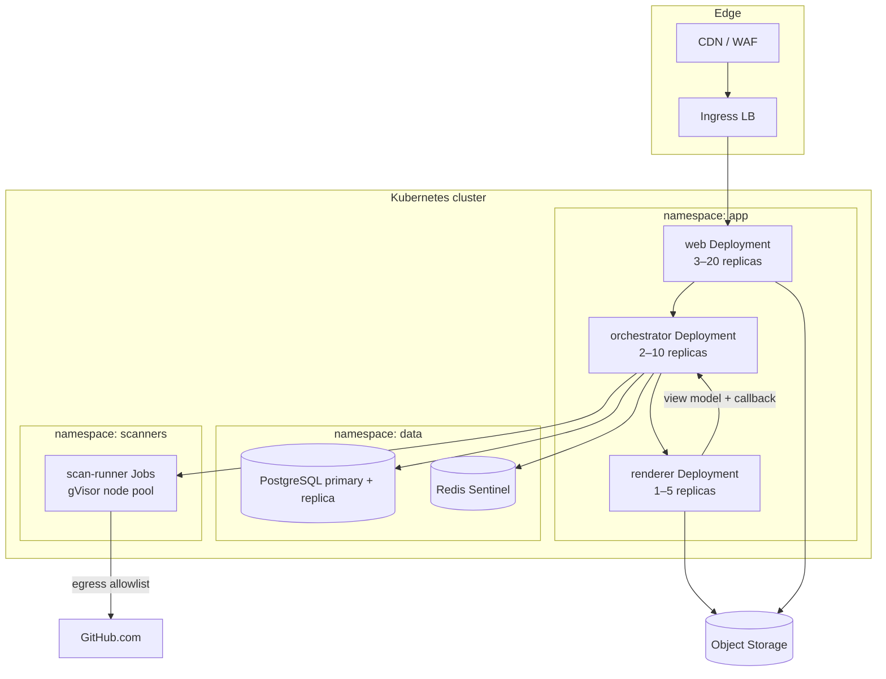

# DPDPA GitHub Code Auditor — System Architecture

| Field | Value |
|---|---|
| Document version | 1.0 |
| Status | Approved for MVP build |
| Date | 2026-11-04 |
| Audience | Engineering, SRE, security review, enterprise customers |
| Related documents | `PRD.md`, `database.md`, `api.md`, `security.md`, `rules.md`, `tasks.md` |

---

## 1. Architecture summary

The product is a multi-tenant SaaS with four deployable workloads:

1. **`web`** — Nuxt 4 application. Nitro is the only public HTTP surface: SSR, session handling, request validation, rate limiting, PDF download, and a typed proxy to the orchestrator.
2. **`orchestrator`** — NestJS (Fastify) service. Owns the domain model, Prisma access to PostgreSQL, scan lifecycle, rule mapping, scoring, and the internal API.
3. **`scan-runner`** — a Python 3.12 application in a hardened container image (Git, Semgrep, Checkov, Gitleaks). It runs as a short-lived Kubernetes Job per scan.
4. **`renderer`** — a small Puppeteer service that renders report HTML to PDF and uploads it to object storage.

Supporting infrastructure: PostgreSQL 16 (system of record), Redis 7 (BullMQ queues and rate-limit counters), S3-compatible object storage (PDFs and optional raw SARIF), and a Kubernetes cluster with a dedicated scanner node pool.

### Core principles

- **One public API.** Customers and the browser only talk to Nitro. Internal services are not internet-reachable.
- **One writer.** Only the orchestrator writes to PostgreSQL. Nitro never opens a database connection.
- **Code never persists.** Repository contents live in an `emptyDir` inside the scan pod and die with it.
- **Deterministic output.** A scan's score is a pure function of findings, rule-pack version, and scoring version.
- **Fail visible, not silent.** Partial scanner coverage is reported explicitly; a missing scanner never yields a falsely clean score.
- **Every boundary is authenticated.** Browser → Nitro uses a session cookie or API key; Nitro → orchestrator uses HMAC + network policy; runner → orchestrator uses a per-scan HMAC secret delivered in the Job's Kubernetes Secret.

---

## 2. System context



### Trust boundaries

| Boundary | Untrusted input | Control |
|---|---|---|
| Browser → edge | Cookies, JSON bodies, repo URLs, filters | TLS, CSP, CSRF, schema validation, rate limits |
| Edge → Nitro | Forwarded headers, client IP | Trusted proxy configuration; ignore client-supplied identity headers |
| Nitro → orchestrator | Internal DTOs | Private network, HMAC signature, request ID, org/user claims |
| GitHub → runner (clone) | git smart-HTTP responses | DNS-pinned `github.com`, no redirects, `GIT_TERMINAL_PROMPT=0`, repo-size cap, depth 1 |
| Orchestrator → runner | Scan spec | K8s Secret with per-scan HMAC, short TTL |
| Runner → orchestrator | Findings payload | Per-scan HMAC over timestamp + body, payload size cap |
| Runner → internet | Git clone, no other egress | NetworkPolicy allowlist to GitHub only |
| Orchestrator → PostgreSQL | Queries | Parameterised Prisma queries, least-privilege DB role, TLS |

---

## 3. Container diagram



### Responsibilities

| Component | Owns | Must not |
|---|---|---|
| `web` | Sessions, SSR, route guards, CSRF, rate limiting, public OpenAPI surface, PDF download redirect | Access PostgreSQL, hold GitHub credentials, run scanners |
| `orchestrator` | Repositories, scans, findings, rules, scoring, retention, audit log, internal API | Serve public traffic, clone code, render PDFs |
| `scan-runner` (Python 3.12) | Clone, scanner execution, normalisation, redaction, fingerprinting, batched callback | Persist code, access the database, call arbitrary internet hosts, map or score findings |
| `renderer` | HTML → PDF, template versioning, S3 upload | Read source code, mutate scan data |

**Language boundary:** Python owns clone → scanners → normalise → redact → fingerprint → batched callback (`apps/scan-runner`, `pyproject.toml`, `src/`, `tests/`); TypeScript owns map → score → persist in the orchestrator, keeping scoring and mapping contracts in `packages/contracts`.

Queue workers are processes inside the `orchestrator` Deployment (ADR-007); `queue-worker` is not a separate deployable workload. The product has four deployable workloads (§1).

---

## 4. Monorepo layout

```
dpdpa-auditor/
├── apps/
│   ├── web/                      # Nuxt 4 application
│   │   ├── app/                  # pages, components, layouts, composables
│   │   ├── server/               # Nitro routes, middleware, plugins
│   │   └── shared/               # web-only types and validation
│   ├── orchestrator/             # NestJS service
│   │   ├── src/modules/          # auth, orgs, repos, scans, rules, reports, audit
│   │   ├── src/queue/            # BullMQ processors
│   │   └── prisma/               # schema, migrations, seed
│   ├── renderer/                 # Puppeteer report service
│   └── scan-runner/              # Python 3.12: pyproject.toml, src/, tests/
├── packages/
│   ├── contracts/                # Zod schemas and generated TS types
│   ├── rule-packs/               # YAML DPDPA controls and mappings
│   └── config/                   # ESLint, TS, Tailwind presets
├── infra/
│   ├── helm/                     # charts for web, orchestrator, renderer
│   ├── k8s/                      # namespaces, network policies, job templates
│   └── terraform/                # cluster, Postgres, Redis, S3, DNS
├── tests/
│   ├── golden-repos/             # fixture repositories
│   ├── e2e/                      # Playwright
│   └── load/                     # k6 scenarios
└── docs/
```

Tooling: pnpm workspaces, Turborepo task graph, Node 22 LTS, TypeScript 5.x strict, Changesets for versioning shared packages; Python 3.12 with `pyproject.toml` for `apps/scan-runner` (uv/pip tooling, Ruff, mypy, pytest — see code_style.md §13).

---

## 5. Scan request lifecycle

```mermaid
sequenceDiagram
  autonumber
  actor U as User
  participant W as web (Nitro)
  participant O as orchestrator
  participant R as Redis/BullMQ
  participant K as Kubernetes API
  participant J as scan-runner Job
  participant G as GitHub
  participant DB as PostgreSQL
  participant S as Object Storage

  U->>W: POST /api/v1/scan {repositoryId | githubUrl, ref}
  W->>W: Session, CSRF, org role, plan-limit pre-check (defense-in-depth), Zod validation (github.com allowlist, HTTPS)
  W->>O: POST /internal/v1/scans (HMAC, requestId)
  O->>G: git ls-remote --symref (resolve default branch, size probe; no auth)
  O->>DB: Insert scan (queued) or return existing by idempotency key
  O->>R: Enqueue scan.execute {scanId}
  O-->>W: 202 {scanId, statusUrl}
  W-->>U: 202 {scanId, statusUrl}

  R->>O: Worker picks job
  O->>DB: status=cloning
  O->>K: Create Job scan-<id> (scanner node pool)
  K->>J: Start pod
  J->>J: Decode repo spec; clone URL pinned to github.com
  J->>G: git clone --depth 1 --single-branch (GIT_TERMINAL_PROMPT=0, no redirects)
  J->>DB: (never)
  J->>J: Semgrep → Checkov → Gitleaks
  J->>J: Normalise, dedupe, redact
  J->>O: POST /internal/v1/scans/:id/findings (HMAC, batch)
  O->>DB: status=mapping; insert findings
  O->>O: Map to DPDPA, score, persist section rollups
  O->>DB: status=completed, score, counts
  O->>R: Enqueue report.render if requested
  J->>J: Exit; emptyDir deleted
  K->>K: Job TTL cleanup (300s)

  U->>W: GET /api/v1/scan/:id (poll 2s)
  W->>O: GET /internal/v1/scans/:id
  O-->>W: status + score + counts
  W-->>U: 200
```

### Submission invariants

- **Authoritative plan limits:** the orchestrator enforces plan limits (§9); Nitro's pre-check is defense-in-depth only.
- **One active scan per repository ref:** enforced by a partial unique index on `scans (org_id, repo_id, ref)` across active statuses (see `database.md` §4.7); a duplicate submission returns `409 SCAN_IN_PROGRESS`.
- **No orphaned queued scans:** the scan row and its queue entry are written through a transactional outbox; a reconciler re-enqueues rows stuck in `queued` without a dispatched job.

### Timing budget (100 MB repository, p95)

| Stage | Budget |
|---|---|
| Validation + enqueue | 300 ms |
| Queue wait | 60 s |
| Pod schedule + image pull (warm) | 15 s |
| Clone | 45 s |
| Semgrep | 120 s |
| Checkov | 60 s |
| Gitleaks | 20 s |
| Normalise + callback | 15 s |
| Mapping + scoring | 5 s |
| **Total** | **< 6 min** (10 min SLO) |

---

## 6. Ephemeral execution model

### 6.1 Why Kubernetes Jobs

A long-lived scanner worker would accumulate state, share a filesystem, and make cross-tenant isolation a configuration problem. A Job per scan makes isolation structural: one pod, one repository, one lifetime. The scheduler provides bin-packing; the cluster autoscaler provides elasticity; the Job controller provides retries and TTL cleanup.

### 6.2 Job specification invariants

```yaml
apiVersion: batch/v1
kind: Job
metadata:
  name: scan-<scanId>
  namespace: scanners
  labels:
    app.kubernetes.io/name: scan-runner
    dpdpa.io/scan-id: <scanId>
    dpdpa.io/org-id: <orgId>
spec:
  backoffLimit: 0
  activeDeadlineSeconds: 900
  ttlSecondsAfterFinished: 300
  template:
    metadata:
      annotations:
        sidecar.istio.io/inject: "false"
    spec:
      runtimeClassName: gvisor
      restartPolicy: Never
      automountServiceAccountToken: false
      nodeSelector:
        workload: scanner
      tolerations:
        - key: workload
          operator: Equal
          value: scanner
          effect: NoSchedule
      securityContext:
        runAsNonRoot: true
        runAsUser: 10001
        runAsGroup: 10001
        fsGroup: 10001
        seccompProfile:
          type: RuntimeDefault
      containers:
        - name: runner
          image: registry.example.com/dpdpa/scan-runner@sha256:<digest>
          imagePullPolicy: IfNotPresent
          command: ["/usr/local/bin/run-scan"]
          envFrom:
            - secretRef:
                name: scan-<scanId>
          env:
            - name: SCAN_ID
              value: "<scanId>"
            - name: ORCHESTRATOR_URL
              value: "https://orchestrator.internal"
          resources:
            requests: { cpu: "1", memory: "2Gi", ephemeral-storage: "2Gi" }
            limits:   { cpu: "2", memory: "4Gi", ephemeral-storage: "6Gi" }
          securityContext:
            allowPrivilegeEscalation: false
            readOnlyRootFilesystem: true
            capabilities: { drop: ["ALL"] }
          volumeMounts:
            - { name: workspace, mountPath: /workspace }
            - { name: tmp, mountPath: /tmp }
            - { name: cache, mountPath: /home/scanner/.cache }
      volumes:
        - name: workspace
          emptyDir: { sizeLimit: "6Gi" }
        - name: tmp
          emptyDir: { sizeLimit: "512Mi" }
        - name: cache
          emptyDir: { sizeLimit: "512Mi" }
```

### 6.3 Runtime controls

| Control | Implementation |
|---|---|
| Kernel isolation | gVisor `RuntimeClass`; no host PID, IPC, or network namespace sharing |
| Filesystem | Read-only root; writable `emptyDir` only; no PVC; no hostPath |
| Identity | Non-root UID 10001; no service-account token mounted |
| Network | Egress allowlist: DNS, `github.com`, `api.github.com`, `codeload.github.com`, orchestrator; ingress denied |
| Resources | CPU/memory/ephemeral-storage limits; `activeDeadlineSeconds: 900` |
| Image integrity | Digest-pinned image, cosign signature verified by admission policy |
| Secrets | Per-scan K8s Secret with clone URL/ref spec and callback HMAC key, `ownerReferences` to Job; deleted with Job |
| Retention | `emptyDir` deleted on pod termination; Job and Secret removed after 300 s |

### 6.4 What the runner is allowed to send back

- Normalised finding records: scanner, rule ID, severity, file path, line range, message, confidence, redacted evidence, fingerprint.
- Scanner metadata: version, duration, exit code, coverage status.
- Aggregate counts.
- **Never:** file contents, repository archives, environment variables, credentials, raw secret values, commit diffs.

Secret findings are reduced to: rule ID, file path, line, a salted hash of the matched value, and a masked preview limited to a fixed prefix (for example `AKIA…` plus length). The raw value is discarded in memory and never logged.

---

## 7. Service interactions

### 7.1 Nitro → orchestrator

- Transport: HTTPS over the cluster network, `orchestrator.internal` ClusterIP.
- Auth: `X-Internal-Key` (rotated secret) plus `X-Signature: HMAC-SHA256(timestamp + "." + body)`; 5-minute clock skew.
- Claims: `X-Org-Id`, `X-User-Id`, `X-Request-Id`, `X-Idempotency-Key` where applicable.
- Timeout: 5 s connect, 15 s read; retries only for idempotent GETs.
- NetworkPolicy: only pods labelled `app=web` and `app=renderer` may reach port 3001.

### 7.2 Orchestrator → Kubernetes

- Uses a dedicated ServiceAccount with RBAC limited to `create`, `get`, `list`, `delete` Jobs and Secrets in the `scanners` namespace.
- **Order decided: Secret → Job.** Creates the per-scan Secret first (deterministic name `scan-<scanId>`), then the Job with `envFrom`; if Job creation fails, the Secret is deleted immediately. After the Job exists, the Secret is patched with an `ownerReference` to the Job so Kubernetes garbage collection removes it if the Job is deleted. The orchestrator records both names on the scan row and deletes both explicitly on cancel or TTL cleanup.
- Watches Job conditions with a 15-minute deadline, independent of the runner callback.

### 7.3 Runner → orchestrator callback

- `POST /internal/v1/scans/:scanId/findings` with batched payloads (≤ 500 findings or 1 MB).
- Auth: per-scan HMAC only — `X-Internal-Signature: HMAC-SHA256(secret, timestamp + "." + rawBody)` with 5-minute skew; the secret is delivered in the Job's K8s Secret. The Job mounts no service-account token (`automountServiceAccountToken: false`), and callback auth deliberately requires no cluster-wide Kubernetes API permissions (see §15).
- Idempotent by `(scanId, batchId)`; duplicates are ignored.
- Final `POST /internal/v1/scans/:scanId/complete` carries scanner statuses and counts.
- Orchestrator rejects callbacks for scans not in `cloning` or `scanning`.

### 7.4 Orchestrator → renderer

- Enqueue `report.render` with `reportId`, `scanId`, template version.
- Renderer fetches the report view model from `GET /internal/v1/reports/:id/view-model` (read-only, HMAC).
- Renderer uploads to S3 at `reports/<orgId>/<scanId>/<reportId>.pdf`, computes SHA-256, calls back with the key and checksum.
- Browser never receives the S3 key; Nitro issues a 15-minute signed URL after an authorization check.

---

## 8. Data architecture

| Store | Data | Retention |
|---|---|---|
| PostgreSQL | Orgs, users, memberships, repos, scans, findings, rules, mappings, reports metadata, audit logs | Org policy; default 90 days for scans; audit 1 year |
| Redis | BullMQ jobs, locks, rate-limit counters, short-lived caches | Job TTL + 24 h; counters minutes |
| S3 | PDF reports; optional raw SARIF | PDF 30 days default; SARIF 24 h if enabled |
| Scan pod `emptyDir` | Cloned source and scanner output | Deleted with pod; hard maximum 15 min |
| Logs | Structured application logs | 30 days hot, 90 days cold; PII scrubbed |

Source code is never written to PostgreSQL, Redis, S3, or logs. The only code-derived data that persists is file path, line range, rule identity, message, redacted evidence, and fingerprint.

See `database.md` for the schema and `security.md` for the deletion proof.

---

## 9. Multi-tenancy and isolation

- **Tenant key:** `org_id` on every domain row.
- **Application scoping:** every repository query includes `org_id` from the verified session; never from the request body.
- **Database:** single database, shared schema. Optional PostgreSQL RLS policy using `SET LOCAL app.current_org` as defence in depth; application-level scoping is mandatory regardless.
- **Object storage:** key prefix per org; bucket policy denies unauthenticated access; signed URLs only.
- **Queue:** job payloads contain IDs only; workers re-load the row and verify `org_id`.
- **Scan pods:** one org's code per pod; NetworkPolicy prevents pod-to-pod traffic; no shared cache volume.
- **Rate limiting:** per user, per org, per IP at the edge, and per org plan in the orchestrator. The orchestrator is authoritative for plan limits; edge checks are defense-in-depth.
- **Noisy neighbour:** per-org concurrency cap (default 3, Enterprise configurable) and global cap enforced by BullMQ.

---

## 10. Failure handling

| Failure | Detection | Behaviour |
|---|---|---|
| GitHub availability / abuse limit (git smart-HTTP) | Clone connection errors, 429s from GitHub | Exponential backoff with jitter; scan stays `queued` up to 10 min, then fails with `GITHUB_RATE_LIMITED`; degraded-mode banner (operations.md) |
| Repository not found or private (404 on anonymous clone) | Clone exit code | Fail with `REPO_NOT_FOUND`/`REPO_NOT_ACCESSIBLE` — the same non-leaking error for private and nonexistent repositories (no existence oracle) |
| Repository too large | Pre-flight size check | Fail fast with `REPO_TOO_LARGE` and the limit in the message |
| Scanner timeout | Per-scanner deadline | Kill scanner, mark that scanner `timed_out`, continue with others; coverage warning |
| Scanner crash | Non-zero exit | Mark `failed`, continue; score computed with explicit coverage penalty |
| Pod OOM | Job condition `OOMKilled` | Retry once with a larger memory class if plan allows; then fail |
| Callback lost | Orchestrator Job watcher | Job success without callback → `INCOMPLETE_RESULTS`; retry callback fetch from pod logs is not possible, so the scan fails visibly |
| Orchestrator restart | Durable BullMQ job | Job re-delivered; processor is idempotent by `scanId` |
| Redis unavailable | Health check | Scans queue at the API with `503` and `Retry-After`; reads continue |
| PostgreSQL failover | Connection errors | Prisma retry with backoff; reads served from retry; RPO 15 min |
| PDF render failure | Renderer callback timeout | Report `failed`; user can retry; no partial file is served |
| Duplicate scan submission | Unique `(org_id, idempotency_key)` | Return existing scan with `200` instead of creating a second |
| Cancellation race | Status check before each stage | Cancelled scan terminates Job; late callbacks are rejected |

### Retry policy

- Queue jobs: 3 attempts, exponential backoff `30s, 2m, 10m`, then dead-letter queue with alert.
- GitHub API: 3 attempts, respect `Retry-After`.
- Internal HTTP: GET only, 2 attempts, 1 s timeout budget.
- Non-idempotent POSTs: never retried automatically; the client uses an idempotency key.

---

## 11. Deployment topology



### Environments

| Environment | Purpose | Data | Access |
|---|---|---|---|
| Local | Development | Docker Compose: Postgres, Redis, MinIO, mock GitHub; kind for Jobs | Developer |
| Preview | Per-PR UI/API review | Ephemeral namespace, seeded fixtures | Team |
| Staging | Pre-production verification | Anonymised fixtures and golden repos | Team + design partners |
| Production | Customers | Real tenant data, India region | Break-glass only |

### Release flow

1. CI builds and signs images; SBOM and Trivy report attached.
2. Argo CD syncs staging; migrations run as a pre-sync Job.
3. Automated smoke tests and the golden-repo suite run against staging.
4. Production sync is manual; web and orchestrator roll out with `maxSurge: 1`, `maxUnavailable: 0`.
5. Canary at 10% for 15 minutes; SLO burn-rate alert triggers automatic rollback.
6. Migrations follow expand/contract: add nullable columns, backfill, switch reads, drop later.

---

## 12. Scaling and capacity

### Assumptions at launch

- 200 orgs, 2,000 repositories, 20,000 scans/month.
- Average scan: 2 vCPU, 4 GiB, 5 minutes; p95 10 minutes.
- Monthly compute: ~1,700 CPU-hours and ~3,400 GiB-hours.
- Peak: 10 scans/minute; 50 concurrent Jobs.

### Scaling controls

| Component | Mechanism | Bounds |
|---|---|---|
| `web` | HPA on CPU and request rate | 3–20 replicas |
| `orchestrator` | HPA on CPU and queue depth | 2–10 replicas |
| Queue workers | KEDA on BullMQ `waiting` length | 2–30 consumers |
| Scan Jobs | Cluster autoscaler on scanner node pool | 0–60 nodes, 4 Jobs/node |
| `renderer` | HPA on queue depth | 1–5 replicas |
| PostgreSQL | Vertical + read replica | 8 vCPU / 32 GiB at launch |
| Redis | Sentinel, 3 nodes | 4 GiB each |

### Cost guardrails

- Per-scan budget alarm at US$0.40; page at US$0.60.
- Anonymous `git clone` over smart-HTTP consumes no GitHub API quota; the binding constraints are the repo-size caps, per-org concurrency caps, and the scan-plan limits above.
- Repositories above 250 MB require a Growth plan and use a reduced scanner profile.
- Idle scanner nodes scale to zero outside business hours where latency allows.
- Raw SARIF storage is opt-in and TTL-bound at 24 hours.

---

## 13. Observability

### Traces

OpenTelemetry across Nitro → orchestrator → Kubernetes Job → callback. W3C `traceparent` is propagated in internal headers and injected into the Job as `TRACEPARENT`. Scanner spans record duration and exit code, never output content.

### Metrics

| Metric | Type | Alert |
|---|---|---|
| `scan_queue_depth` | gauge | > 50 for 10 min |
| `scan_duration_seconds` | histogram | p95 > 10 min for 15 min |
| `scan_failure_rate` | ratio | > 5% for 10 min |
| `scanner_partial_rate` | ratio | > 10% for 30 min |
| `api_request_duration_seconds` | histogram | p95 > 400 ms for 10 min |
| `api_5xx_rate` | ratio | > 1% for 5 min |
| `report_render_duration_seconds` | histogram | p95 > 10 s |
| `job_oom_total` | counter | any increase |
| `source_retention_violation_total` | counter | any value > 0 (P1) |
| `auth_failure_rate` | ratio | > 20% for 5 min |

This is the launch metric set; the complete alert catalog with severities, on-call recipients, and runbook links lives in `operations.md`.

### Logs

- JSON structured logs with `requestId`, `orgId`, `scanId`, `route`, `status`, `durationMs`.
- Redaction allowlist: never log tokens, cookies, repo contents, secret values, or raw scanner output.
- Retention: 30 days hot, 90 days cold.

### Dashboards

1. **Customer health:** scans/day, success rate, p95 duration, partial coverage, top failure codes.
2. **Platform:** API latency/errors, DB connections, Redis memory, queue depth, pod restarts.
3. **Security:** auth failures, rate-limit hits, repository-URL validation rejections, retention violations.
4. **Cost:** CPU/GiB-hours per scan, storage, egress, cost per org.

---

## 14. Architecture decisions

### ADR-001 — Nuxt Nitro is the only public API

**Status:** Accepted. **Context:** The product needs SSR, session cookies, and a small public API. **Decision:** Nitro serves the app and proxies all domain calls. **Alternatives:** expose NestJS directly behind the ingress; use a separate API gateway. **Consequences:** one auth and validation surface; an extra network hop; Nitro must stay thin.

### ADR-002 — Separate NestJS orchestrator

**Status:** Accepted. **Context:** Scan orchestration, queueing, and mapping are long-running and security-sensitive. **Decision:** a dedicated NestJS service owns the domain and database. **Alternatives:** put everything in Nitro server routes; use Django. **Consequences:** clean boundary and independent scaling; more deployment surface; shared contracts package is required.

### ADR-003 — One Kubernetes Job per scan

**Status:** Accepted. **Context:** Tenant code must be isolated and destroyed. **Decision:** ephemeral Job with gVisor and `emptyDir`. **Alternatives:** long-lived workers with per-job temp dirs; Firecracker microVMs. **Consequences:** strong isolation and simple cleanup; higher cold-start cost; scanner images must be pre-pulled.

### ADR-004 — GitHub App over user OAuth for repository access

**Status:** Superseded by ADR-011. **Context:** OAuth user tokens are broad and long-lived. **Decision:** short-lived, repo-scoped GitHub App credentials for cloning; OAuth only for identity. **Alternatives:** fine-grained PATs; OAuth with repo scope. **Consequences:** least privilege and central revocation; App install UX and webhook handling required.

### ADR-005 — Orchestrator exclusively owns PostgreSQL

**Status:** Accepted. **Context:** Two writers create schema drift and confused ownership. **Decision:** Prisma in the orchestrator; Nitro has no DB driver. **Alternatives:** Drizzle in Nitro for read models; direct SQL from both. **Consequences:** one migration path and one audit trail; Nitro read latency depends on the internal API.

### ADR-006 — Normalise to an internal finding schema

**Status:** Accepted. **Context:** Semgrep emits SARIF, Checkov emits JSON/SARIF, Gitleaks emits JSON. **Decision:** adapters convert all output to `NormalizedFinding` before mapping. **Alternatives:** map directly from each format. **Consequences:** one mapping engine and one UI; adapters must be maintained per scanner upgrade.

### ADR-007 — BullMQ on Redis for orchestration

**Status:** Accepted. **Context:** Need delayed retries, concurrency control, and job visibility. **Decision:** BullMQ with per-scan job IDs. **Alternatives:** Kubernetes-native queue; SQS. **Consequences:** Redis becomes critical infrastructure; job idempotency is mandatory.

### ADR-008 — Separate Puppeteer renderer

**Status:** Accepted. **Context:** Chromium is memory-hungry and a crash risk. **Decision:** dedicated renderer deployment consuming a queue. **Alternatives:** render inside Nitro; third-party PDF API. **Consequences:** stable web latency and independent scaling; another service to operate; customer data still stays in-cluster.

### ADR-009 — pnpm monorepo with shared contracts

**Status:** Accepted. **Context:** Nitro and NestJS must agree on payloads. **Decision:** pnpm + Turborepo + `packages/contracts` with Zod schemas. **Alternatives:** separate repos with published clients. **Consequences:** atomic contract changes; larger CI graph; release coupling.

### ADR-010 — Zero-retention by construction, not by cleanup job

**Status:** Accepted. **Context:** A cleanup cron can fail silently. **Decision:** source lives only on pod `emptyDir`; no code path writes it elsewhere. **Alternatives:** scan then delete from a PVC; object-storage staging. **Consequences:** no post-hoc debugging on source; deletion is verifiable by architecture rather than by a job.

### ADR-011 — URL-only public scanning at MVP

**Status:** Accepted. **Context:** A GitHub App flow adds install UX, App-credential minting and caching, webhook handling, and per-repo visibility configuration before a user can run a first scan — friction that delays the core value (paste URL → DPDPA report) and expands the security surface. **Decision:** MVP scans public repositories only, submitted by pasting `https://github.com/<owner>/<repo>`; resolution and clone are anonymous over git smart-HTTP (`git ls-remote`, depth 1, no redirects). OAuth remains identity-only. **Alternatives:** ship the App at MVP (rejected: install friction, token caching, webhook surface); fine-grained PATs (rejected: secret handling, revocation). **Consequences:** first scan in under a minute with zero GitHub configuration; no private-repo scanning, no repository listing, no webhook-triggered rescans — these return with the GitHub App in the post-MVP backlog, which supersedes ADR-004.

---

## 15. Rejected alternatives and trade-offs

| Alternative | Why rejected |
|---|---|
| Serverless functions for scanning | 15-minute limits, large image sizes, weak isolation for hostile code |
| Single monolith (Nuxt only) | Long scans and queue workers would compete with SSR; weaker security boundary |
| Shared scanner workers with temp directories | Cross-tenant residue risk; noisy-neighbour CPU contention; cleanup depends on code correctness |
| Storing repositories for re-scan | Directly violates the zero-retention promise and expands breach scope |
| Direct browser → orchestrator API | Two public surfaces; duplicated auth; larger attack surface |
| GraphQL | REST is sufficient; cacheability and simple CI clients matter more than query flexibility |
| Mapping inside each scanner adapter | Duplicated logic and inconsistent clause coverage |
| Running Puppeteer in Nitro | Memory spikes would degrade SSR and API latency |
| Service-account token auth for runner callbacks | Would require cluster-wide Kubernetes API permissions, conflicting with the namespace-only RBAC in `security.md` §5.3; a per-scan HMAC secret is sufficient inside the `scanners` namespace |

---

## 16. Open technical questions

1. mTLS via service mesh versus HMAC-only for internal calls at launch.
2. Whether to enable PostgreSQL RLS for all tenants or only Enterprise.
3. Scanner image distribution: pre-pulled DaemonSet versus lazy pull with a warm cache.
4. Retention of raw SARIF for customer debugging (opt-in, 24 h) versus no raw artifacts at all.
5. Multi-region read replicas for latency versus data-residency simplicity.
6. Whether to support customer-managed encryption keys for PDFs at Enterprise.
