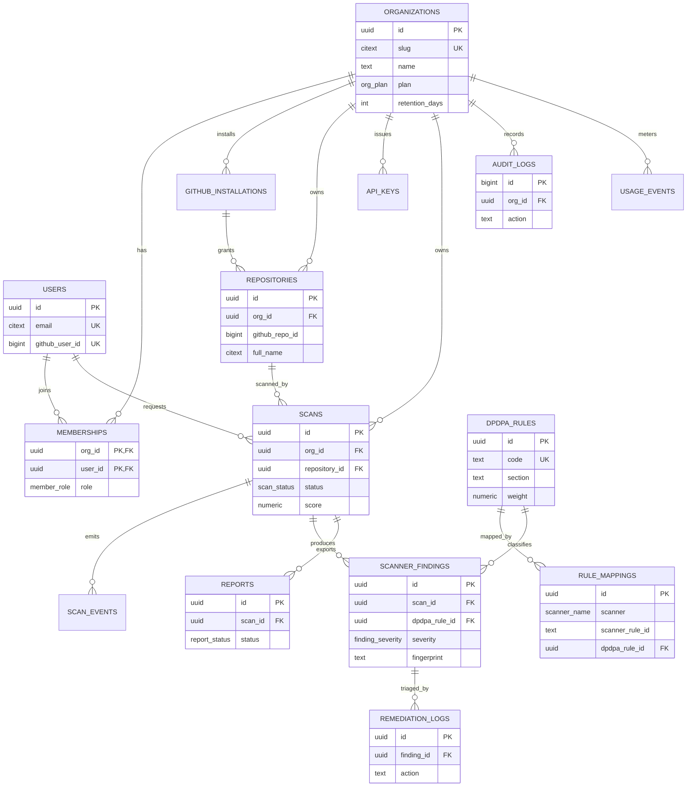

# DPDPA GitHub Code Auditor — Database Design

| Field | Value |
|---|---|
| Database | PostgreSQL 16 |
| ORM | Prisma (orchestrator only) |
| Document version | 1.0 |
| Date | 2026-11-04 |
| Related documents | `architecture.md`, `api.md`, `security.md`, `rules.md` |

---

## 1. Design principles

- **Single writer.** Only the NestJS orchestrator connects to PostgreSQL. Nitro and the renderer use the internal API.
- **Tenant key everywhere.** Every tenant-owned table carries `org_id`, indexed, and every query filters on it.
- **UUID primary keys.** `gen_random_uuid()` for internal keys; public APIs expose prefixed IDs (`org_`, `repo_`, `scn_`, `fnd_`, `rpt_`).
- **Timestamps in UTC.** All `timestamptz`; the UI localises.
- **Soft delete only where recovery matters.** Organisations, users, and repositories use `deleted_at`; scans and findings are hard-deleted by retention.
- **Enums for closed sets.** PostgreSQL enums for status, severity, and role; text for open sets such as audit actions.
- **No source code.** File paths and line numbers are permitted; contents are not. Evidence is redacted.
- **Reproducibility.** Every scan records `rule_pack_version` and `scoring_version`.
- **Append-only audit.** `audit_logs` and `remediation_logs` are never updated or deleted by application code.

---

## 2. Entity-relationship diagram



---

## 3. Enumerated types

```sql
CREATE EXTENSION IF NOT EXISTS pgcrypto;
CREATE EXTENSION IF NOT EXISTS citext;

CREATE TYPE org_plan AS ENUM ('free', 'starter', 'growth', 'enterprise');

CREATE TYPE member_role AS ENUM ('owner', 'admin', 'auditor', 'viewer');
CREATE TYPE membership_status AS ENUM ('invited', 'active', 'suspended');

CREATE TYPE repo_visibility AS ENUM ('public', 'private', 'internal');

CREATE TYPE scan_status AS ENUM (
  'queued', 'cloning', 'scanning', 'mapping',
  'completed', 'failed', 'cancelled', 'expired'
);
CREATE TYPE scan_trigger AS ENUM ('manual', 'api', 'scheduled', 'webhook');

CREATE TYPE scanner_name AS ENUM ('semgrep', 'checkov', 'gitleaks');
CREATE TYPE scanner_status AS ENUM ('pending', 'running', 'completed', 'failed', 'timed_out', 'skipped');

CREATE TYPE finding_severity AS ENUM ('critical', 'high', 'medium', 'low', 'info');
CREATE TYPE finding_status AS ENUM ('open', 'false_positive', 'accepted_risk', 'fixed', 'reopened');
CREATE TYPE mapping_confidence AS ENUM ('direct', 'inferred', 'advisory');

CREATE TYPE report_status AS ENUM ('queued', 'rendering', 'ready', 'failed', 'expired');
CREATE TYPE report_format AS ENUM ('pdf');
```

### Enum rules

- Adding a value is backward compatible; removing one requires a migration that rewrites existing rows.
- Prisma enums must mirror these exactly. A CI check diffs `prisma/schema.prisma` against `information_schema` in integration tests.
- `expired` is a terminal scan status used by retention before hard deletion.

---

## 4. Core schema

### 4.1 Organisations

```sql
CREATE TABLE organizations (
  id                 uuid PRIMARY KEY DEFAULT gen_random_uuid(),
  name               text NOT NULL CHECK (char_length(name) BETWEEN 2 AND 120),
  slug               citext NOT NULL UNIQUE
                     CHECK (slug ~ '^[a-z0-9][a-z0-9-]{1,38}[a-z0-9]$'),
  plan               org_plan NOT NULL DEFAULT 'free',
  data_region        text NOT NULL DEFAULT 'ap-south-1'
                     CHECK (data_region IN ('ap-south-1', 'ap-south-2', 'eu-central-1')),
  retention_days     integer NOT NULL DEFAULT 90
                     CHECK (retention_days BETWEEN 7 AND 365),
  scan_concurrency   smallint NOT NULL DEFAULT 3
                     CHECK (scan_concurrency BETWEEN 1 AND 20),
  billing_customer_id text UNIQUE,
  settings           jsonb NOT NULL DEFAULT '{}'::jsonb,
  created_at         timestamptz NOT NULL DEFAULT now(),
  updated_at         timestamptz NOT NULL DEFAULT now(),
  deleted_at         timestamptz
);

CREATE INDEX idx_orgs_plan ON organizations (plan) WHERE deleted_at IS NULL;
CREATE INDEX idx_orgs_deleted ON organizations (deleted_at);
```

`settings` holds feature flags and notification preferences, validated by a JSON schema in the application. It must never hold secrets.

### 4.2 Users

```sql
CREATE TABLE users (
  id               uuid PRIMARY KEY DEFAULT gen_random_uuid(),
  email            citext NOT NULL UNIQUE
                   CHECK (email ~* '^[^@\s]+@[^@\s]+\.[^@\s]+$'),
  name             text,
  avatar_url       text,
  github_user_id   bigint UNIQUE,
  email_verified_at timestamptz,
  last_login_at    timestamptz,
  created_at       timestamptz NOT NULL DEFAULT now(),
  updated_at       timestamptz NOT NULL DEFAULT now(),
  deleted_at       timestamptz
);

CREATE INDEX idx_users_github ON users (github_user_id);
CREATE INDEX idx_users_deleted ON users (deleted_at);
```

GitHub is the only identity provider at launch. `email` is the join key for invitations; `github_user_id` is the stable external identity.

### 4.3 Memberships

```sql
CREATE TABLE memberships (
  org_id      uuid NOT NULL REFERENCES organizations(id) ON DELETE CASCADE,
  user_id     uuid NOT NULL REFERENCES users(id) ON DELETE CASCADE,
  role        member_role NOT NULL DEFAULT 'viewer',
  status      membership_status NOT NULL DEFAULT 'invited',
  invited_by  uuid REFERENCES users(id) ON DELETE SET NULL,
  created_at  timestamptz NOT NULL DEFAULT now(),
  updated_at  timestamptz NOT NULL DEFAULT now(),
  PRIMARY KEY (org_id, user_id)
);

CREATE INDEX idx_memberships_user ON memberships (user_id) WHERE status = 'active';
CREATE INDEX idx_memberships_org_role ON memberships (org_id, role);
```

Business rule: an organisation must always have at least one `owner`. Enforced in a transaction on role change and on membership deletion.

### 4.4 GitHub installations

```sql
CREATE TABLE github_installations (
  id                   uuid PRIMARY KEY DEFAULT gen_random_uuid(),
  org_id               uuid NOT NULL REFERENCES organizations(id) ON DELETE CASCADE,
  installation_id      bigint NOT NULL UNIQUE,
  account_login        citext NOT NULL,
  account_type         text NOT NULL CHECK (account_type IN ('User', 'Organization')),
  repository_selection text NOT NULL DEFAULT 'selected'
                       CHECK (repository_selection IN ('all', 'selected')),
  suspended_at         timestamptz,
  created_at           timestamptz NOT NULL DEFAULT now(),
  updated_at           timestamptz NOT NULL DEFAULT now()
);

CREATE INDEX idx_installations_org ON github_installations (org_id);
```

No token is stored here. Installation tokens are minted on demand and cached in memory for at most 50 minutes.

### 4.5 Repositories

```sql
CREATE TABLE repositories (
  id               uuid PRIMARY KEY DEFAULT gen_random_uuid(),
  org_id           uuid NOT NULL REFERENCES organizations(id) ON DELETE CASCADE,
  installation_id  uuid NOT NULL REFERENCES github_installations(id) ON DELETE RESTRICT,
  github_repo_id   bigint NOT NULL,
  full_name        citext NOT NULL
                   CHECK (full_name ~ '^[A-Za-z0-9_.-]+/[A-Za-z0-9_.-]+$'),
  default_branch   text NOT NULL DEFAULT 'main',
  visibility       repo_visibility NOT NULL DEFAULT 'private',
  language         text,
  size_kb          integer CHECK (size_kb >= 0),
  is_archived      boolean NOT NULL DEFAULT false,
  connected_by     uuid REFERENCES users(id) ON DELETE SET NULL,
  last_scanned_at  timestamptz,
  created_at       timestamptz NOT NULL DEFAULT now(),
  updated_at       timestamptz NOT NULL DEFAULT now(),
  deleted_at       timestamptz,
  UNIQUE (org_id, github_repo_id),
  UNIQUE (org_id, full_name)
);

CREATE INDEX idx_repos_org_recent
  ON repositories (org_id, last_scanned_at DESC NULLS LAST)
  WHERE deleted_at IS NULL;
CREATE INDEX idx_repos_installation ON repositories (installation_id);
```

Repository deletion is soft; scans and findings follow the retention policy. `full_name` is case-insensitive because GitHub paths are case-insensitive for lookup.

### 4.6 API keys

```sql
CREATE TABLE api_keys (
  id           uuid PRIMARY KEY DEFAULT gen_random_uuid(),
  org_id       uuid NOT NULL REFERENCES organizations(id) ON DELETE CASCADE,
  name         text NOT NULL CHECK (char_length(name) BETWEEN 1 AND 80),
  key_prefix   text NOT NULL UNIQUE,
  key_hash     text NOT NULL UNIQUE,
  scopes       text[] NOT NULL DEFAULT ARRAY['scan:read']::text[],
  created_by   uuid REFERENCES users(id) ON DELETE SET NULL,
  last_used_at timestamptz,
  expires_at   timestamptz,
  revoked_at   timestamptz,
  created_at   timestamptz NOT NULL DEFAULT now()
);

CREATE INDEX idx_api_keys_org ON api_keys (org_id) WHERE revoked_at IS NULL;
```

Only a SHA-256 hash (or Argon2id hash for higher entropy keys) is stored. The plaintext key is shown once at creation. Scopes are validated against an allowlist: `scan:read`, `scan:write`, `report:read`, `repo:read`.

### 4.7 Scans

```sql
CREATE TABLE scans (
  id                uuid PRIMARY KEY DEFAULT gen_random_uuid(),
  org_id            uuid NOT NULL REFERENCES organizations(id) ON DELETE CASCADE,
  repository_id     uuid NOT NULL REFERENCES repositories(id) ON DELETE CASCADE,
  requested_by      uuid REFERENCES users(id) ON DELETE SET NULL,
  api_key_id        uuid REFERENCES api_keys(id) ON DELETE SET NULL,
  trigger           scan_trigger NOT NULL DEFAULT 'manual',
  status            scan_status NOT NULL DEFAULT 'queued',
  ref               text NOT NULL DEFAULT 'main',
  commit_sha        text CHECK (commit_sha ~ '^[0-9a-f]{40}([0-9a-f]{24})?$'),
  scanner_versions  jsonb NOT NULL DEFAULT '{}'::jsonb,
  rule_pack_version text,
  scoring_version   text,
  score             numeric(5,2) CHECK (score BETWEEN 0 AND 100),
  grade             char(1) CHECK (grade IN ('A', 'B', 'C', 'D', 'F')),
  section_scores    jsonb NOT NULL DEFAULT '{}'::jsonb,
  counts            jsonb NOT NULL DEFAULT '{}'::jsonb,
  coverage          jsonb NOT NULL DEFAULT '{}'::jsonb,
  error_code        text,
  error_message     text,
  idempotency_key   text,
  queued_at         timestamptz NOT NULL DEFAULT now(),
  started_at        timestamptz,
  completed_at      timestamptz,
  duration_ms       integer CHECK (duration_ms >= 0),
  created_at        timestamptz NOT NULL DEFAULT now(),
  updated_at        timestamptz NOT NULL DEFAULT now(),
  UNIQUE (org_id, idempotency_key)
);

CREATE INDEX idx_scans_org_created ON scans (org_id, created_at DESC);
CREATE INDEX idx_scans_repo_created ON scans (repository_id, created_at DESC);
CREATE INDEX idx_scans_active
  ON scans (status, queued_at)
  WHERE status IN ('queued', 'cloning', 'scanning', 'mapping');
CREATE INDEX idx_scans_org_status ON scans (org_id, status);
```

`commit_sha` accepts SHA-1 (40) or SHA-256 (64) repository object IDs. `idempotency_key` is nullable for UI scans that do not supply one; PostgreSQL treats `NULL` values as distinct, so multiple null keys are allowed.

### 4.8 Scan events

```sql
CREATE TABLE scan_events (
  id         bigserial PRIMARY KEY,
  scan_id    uuid NOT NULL REFERENCES scans(id) ON DELETE CASCADE,
  org_id     uuid NOT NULL REFERENCES organizations(id) ON DELETE CASCADE,
  type       text NOT NULL,
  payload    jsonb NOT NULL DEFAULT '{}'::jsonb,
  created_at timestamptz NOT NULL DEFAULT now()
);

CREATE INDEX idx_scan_events_scan ON scan_events (scan_id, created_at);
CREATE INDEX idx_scan_events_org ON scan_events (org_id, created_at DESC);
```

Events are append-only and drive the scan timeline UI: `queued`, `job_created`, `clone_started`, `clone_completed`, `scanner_started`, `scanner_completed`, `mapping_started`, `score_computed`, `completed`, `failed`, `cancelled`. Payloads contain metadata only, never code.

### 4.9 DPDPA rules

```sql
CREATE TABLE dpdpa_rules (
  id                    uuid PRIMARY KEY DEFAULT gen_random_uuid(),
  code                  text NOT NULL UNIQUE,
  section               text NOT NULL,
  title                 text NOT NULL,
  summary               text NOT NULL,
  obligation            text NOT NULL,
  legal_reference       text NOT NULL,
  severity              finding_severity NOT NULL,
  weight                numeric(4,2) NOT NULL DEFAULT 1.0 CHECK (weight > 0),
  applies_when          jsonb NOT NULL DEFAULT '{}'::jsonb,
  remediation_guidance  text NOT NULL,
  version               text NOT NULL DEFAULT '1.0.0',
  is_active             boolean NOT NULL DEFAULT true,
  created_at            timestamptz NOT NULL DEFAULT now(),
  updated_at            timestamptz NOT NULL DEFAULT now()
);

CREATE INDEX idx_rules_section ON dpdpa_rules (section) WHERE is_active;
CREATE INDEX idx_rules_active ON dpdpa_rules (is_active);
```

`code` format: `DPDPA-<section>-<domain>-<sequence>`, for example `DPDPA-8.4-ENC-01`. `applies_when` is a declarative predicate evaluated by the scoring engine (resource types, languages, frameworks).

### 4.10 Rule mappings

```sql
CREATE TABLE rule_mappings (
  id                    uuid PRIMARY KEY DEFAULT gen_random_uuid(),
  dpdpa_rule_id         uuid NOT NULL REFERENCES dpdpa_rules(id) ON DELETE CASCADE,
  scanner               scanner_name NOT NULL,
  scanner_rule_id       text NOT NULL,
  scanner_rule_version text NOT NULL DEFAULT '*',
  confidence            mapping_confidence NOT NULL DEFAULT 'direct',
  rationale             text NOT NULL,
  remediation_template  text,
  is_active             boolean NOT NULL DEFAULT true,
  created_at            timestamptz NOT NULL DEFAULT now(),
  updated_at            timestamptz NOT NULL DEFAULT now(),
  UNIQUE (scanner, scanner_rule_id, scanner_rule_version, dpdpa_rule_id)
);

CREATE INDEX idx_mappings_lookup
  ON rule_mappings (scanner, scanner_rule_id, scanner_rule_version)
  WHERE is_active;
CREATE INDEX idx_mappings_rule ON rule_mappings (dpdpa_rule_id);
```

A scanner rule may map to more than one DPDPA rule (for example, public S3 maps to both confidentiality and access control). The unique constraint prevents duplicate pairs.

### 4.11 Scanner findings

```sql
CREATE TABLE scanner_findings (
  id                   uuid PRIMARY KEY DEFAULT gen_random_uuid(),
  scan_id              uuid NOT NULL REFERENCES scans(id) ON DELETE CASCADE,
  org_id               uuid NOT NULL REFERENCES organizations(id) ON DELETE CASCADE,
  scanner              scanner_name NOT NULL,
  scanner_rule_id      text NOT NULL,
  scanner_rule_version text,
  dpdpa_rule_id        uuid REFERENCES dpdpa_rules(id) ON DELETE SET NULL,
  severity             finding_severity NOT NULL,
  confidence           mapping_confidence NOT NULL DEFAULT 'direct',
  file_path            text,
  line_start           integer CHECK (line_start > 0),
  line_end             integer CHECK (line_end >= line_start),
  column_start         integer CHECK (column_start > 0),
  column_end           integer CHECK (column_end >= column_start),
  message              text NOT NULL,
  evidence_redacted    text,
  evidence_hash        text,
  fingerprint          text NOT NULL,
  status               finding_status NOT NULL DEFAULT 'open',
  is_new               boolean NOT NULL DEFAULT true,
  first_seen_at        timestamptz NOT NULL DEFAULT now(),
  last_seen_at         timestamptz NOT NULL DEFAULT now(),
  context              jsonb NOT NULL DEFAULT '{}'::jsonb,
  created_at           timestamptz NOT NULL DEFAULT now(),
  updated_at           timestamptz NOT NULL DEFAULT now(),
  UNIQUE (scan_id, fingerprint)
);

CREATE INDEX idx_findings_scan_severity ON scanner_findings (scan_id, severity);
CREATE INDEX idx_findings_scan_status ON scanner_findings (scan_id, status);
CREATE INDEX idx_findings_org_rule ON scanner_findings (org_id, dpdpa_rule_id);
CREATE INDEX idx_findings_fingerprint ON scanner_findings (fingerprint);
CREATE INDEX idx_findings_file ON scanner_findings (scan_id, file_path);
```

`fingerprint` is a stable hash of `(scanner, scanner_rule_id, file_path, normalised_snippet_hash, occurrence_index)`. It deliberately excludes line numbers so findings survive code movement. `evidence_hash` is a salted hash of the matched value; `evidence_redacted` is a masked preview that never contains a full secret. `context` holds non-sensitive metadata such as resource type, framework, or policy name.

### 4.12 Remediation logs

```sql
CREATE TABLE remediation_logs (
  id            uuid PRIMARY KEY DEFAULT gen_random_uuid(),
  finding_id    uuid NOT NULL REFERENCES scanner_findings(id) ON DELETE CASCADE,
  org_id        uuid NOT NULL REFERENCES organizations(id) ON DELETE CASCADE,
  actor_user_id uuid REFERENCES users(id) ON DELETE SET NULL,
  action        text NOT NULL CHECK (action IN (
                  'marked_false_positive', 'accepted_risk', 'marked_fixed',
                  'reopened', 'note_added', 'assigned', 'external_ticket_linked'
                )),
  note          text CHECK (char_length(note) <= 4000),
  external_url  text,
  created_at    timestamptz NOT NULL DEFAULT now()
);

CREATE INDEX idx_remediation_finding ON remediation_logs (finding_id, created_at);
CREATE INDEX idx_remediation_org ON remediation_logs (org_id, created_at DESC);
```

Append-only. The current state lives on `scanner_findings.status`; the log explains how it got there. `accepted_risk` requires a note of at least 20 characters, enforced in the service layer.

### 4.13 Reports

```sql
CREATE TABLE reports (
  id               uuid PRIMARY KEY DEFAULT gen_random_uuid(),
  scan_id          uuid NOT NULL REFERENCES scans(id) ON DELETE CASCADE,
  org_id           uuid NOT NULL REFERENCES organizations(id) ON DELETE CASCADE,
  status           report_status NOT NULL DEFAULT 'queued',
  format           report_format NOT NULL DEFAULT 'pdf',
  template_version text NOT NULL,
  storage_key      text UNIQUE,
  sha256           char(64) CHECK (sha256 ~ '^[0-9a-f]{64}$'),
  size_bytes       bigint CHECK (size_bytes > 0),
  requested_by     uuid REFERENCES users(id) ON DELETE SET NULL,
  error_message    text,
  expires_at       timestamptz,
  created_at       timestamptz NOT NULL DEFAULT now(),
  updated_at       timestamptz NOT NULL DEFAULT now()
);

CREATE INDEX idx_reports_scan ON reports (scan_id, created_at DESC);
CREATE INDEX idx_reports_org ON reports (org_id, created_at DESC);
CREATE INDEX idx_reports_expiry ON reports (expires_at) WHERE status = 'ready';
```

One scan can have multiple reports (different template versions). The renderer sets `storage_key`, `sha256`, `size_bytes`, `status='ready'`, and `expires_at = now() + interval '30 days'`.

### 4.14 Audit logs

```sql
CREATE TABLE audit_logs (
  id            bigserial PRIMARY KEY,
  org_id        uuid NOT NULL REFERENCES organizations(id) ON DELETE CASCADE,
  actor_user_id uuid REFERENCES users(id) ON DELETE SET NULL,
  actor_type    text NOT NULL CHECK (actor_type IN ('user', 'api_key', 'system')),
  action        text NOT NULL,
  resource_type text NOT NULL,
  resource_id   uuid,
  ip            inet,
  user_agent    text,
  metadata      jsonb NOT NULL DEFAULT '{}'::jsonb,
  created_at    timestamptz NOT NULL DEFAULT now()
);

CREATE INDEX idx_audit_org_created ON audit_logs (org_id, created_at DESC);
CREATE INDEX idx_audit_resource ON audit_logs (resource_type, resource_id);
CREATE INDEX idx_audit_actor ON audit_logs (actor_user_id, created_at DESC);
```

Audit actions include: `org.created`, `org.updated`, `member.invited`, `member.role_changed`, `repo.connected`, `repo.disconnected`, `scan.started`, `scan.cancelled`, `finding.triaged`, `report.downloaded`, `api_key.created`, `api_key.revoked`, `retention.updated`. `resource_id` is intentionally not a foreign key because the table is polymorphic.

### 4.15 Usage events

```sql
CREATE TABLE usage_events (
  id         bigserial PRIMARY KEY,
  org_id     uuid NOT NULL REFERENCES organizations(id) ON DELETE CASCADE,
  scan_id    uuid REFERENCES scans(id) ON DELETE SET NULL,
  event_type text NOT NULL CHECK (event_type IN (
               'scan_completed', 'scan_failed', 'report_rendered', 'storage_byte_hour'
             )),
  quantity   numeric(12,4) NOT NULL DEFAULT 1 CHECK (quantity >= 0),
  metadata   jsonb NOT NULL DEFAULT '{}'::jsonb,
  created_at timestamptz NOT NULL DEFAULT now()
);

CREATE INDEX idx_usage_org_created ON usage_events (org_id, created_at DESC);
CREATE INDEX idx_usage_type_created ON usage_events (event_type, created_at DESC);
```

Usage is metered for billing and cost attribution. Events are immutable; corrections are new compensating events.

---

## 5. Updated-at trigger

```sql
CREATE OR REPLACE FUNCTION set_updated_at()
RETURNS trigger
LANGUAGE plpgsql
AS $$
BEGIN
  NEW.updated_at = now();
  RETURN NEW;
END;
$$;

CREATE TRIGGER trg_orgs_updated
  BEFORE UPDATE ON organizations
  FOR EACH ROW EXECUTE FUNCTION set_updated_at();

CREATE TRIGGER trg_users_updated
  BEFORE UPDATE ON users
  FOR EACH ROW EXECUTE FUNCTION set_updated_at();

CREATE TRIGGER trg_memberships_updated
  BEFORE UPDATE ON memberships
  FOR EACH ROW EXECUTE FUNCTION set_updated_at();

CREATE TRIGGER trg_installations_updated
  BEFORE UPDATE ON github_installations
  FOR EACH ROW EXECUTE FUNCTION set_updated_at();

CREATE TRIGGER trg_repos_updated
  BEFORE UPDATE ON repositories
  FOR EACH ROW EXECUTE FUNCTION set_updated_at();

CREATE TRIGGER trg_scans_updated
  BEFORE UPDATE ON scans
  FOR EACH ROW EXECUTE FUNCTION set_updated_at();

CREATE TRIGGER trg_rules_updated
  BEFORE UPDATE ON dpdpa_rules
  FOR EACH ROW EXECUTE FUNCTION set_updated_at();

CREATE TRIGGER trg_mappings_updated
  BEFORE UPDATE ON rule_mappings
  FOR EACH ROW EXECUTE FUNCTION set_updated_at();

CREATE TRIGGER trg_findings_updated
  BEFORE UPDATE ON scanner_findings
  FOR EACH ROW EXECUTE FUNCTION set_updated_at();

CREATE TRIGGER trg_reports_updated
  BEFORE UPDATE ON reports
  FOR EACH ROW EXECUTE FUNCTION set_updated_at();
```

---

## 6. Read views

### 6.1 Scan overview

```sql
CREATE VIEW v_scan_overview AS
SELECT
  s.id,
  s.org_id,
  s.repository_id,
  r.full_name AS repository_full_name,
  s.status,
  s.ref,
  s.commit_sha,
  s.score,
  s.grade,
  s.counts,
  s.coverage,
  s.rule_pack_version,
  s.scoring_version,
  s.queued_at,
  s.started_at,
  s.completed_at,
  s.duration_ms,
  s.error_code,
  s.created_at
FROM scans s
JOIN repositories r ON r.id = s.repository_id;
```

### 6.2 Section score rollup

```sql
CREATE VIEW v_scan_section_scores AS
SELECT
  f.scan_id,
  f.org_id,
  dr.section,
  count(*) FILTER (WHERE f.status NOT IN ('false_positive', 'fixed')) AS open_findings,
  count(*) FILTER (WHERE f.severity = 'critical') AS critical_count,
  count(*) FILTER (WHERE f.severity = 'high') AS high_count,
  count(*) FILTER (WHERE f.severity = 'medium') AS medium_count,
  count(*) FILTER (WHERE f.severity = 'low') AS low_count
FROM scanner_findings f
JOIN dpdpa_rules dr ON dr.id = f.dpdpa_rule_id
GROUP BY f.scan_id, f.org_id, dr.section;
```

The authoritative section score is computed in the orchestrator and stored in `scans.section_scores`; the view is for analytics and reconciliation.

---

## 7. Multi-tenancy and row-level security

Application-level scoping is mandatory: every Prisma query includes `org_id` from the verified session. As defence in depth, enable RLS on tenant tables for a restricted application role:

```sql
ALTER TABLE repositories ENABLE ROW LEVEL SECURITY;
ALTER TABLE scans ENABLE ROW LEVEL SECURITY;
ALTER TABLE scanner_findings ENABLE ROW LEVEL SECURITY;
ALTER TABLE reports ENABLE ROW LEVEL SECURITY;
ALTER TABLE audit_logs ENABLE ROW LEVEL SECURITY;

CREATE POLICY tenant_isolation_repos ON repositories
  USING (org_id = current_setting('app.current_org', true)::uuid);

CREATE POLICY tenant_isolation_scans ON scans
  USING (org_id = current_setting('app.current_org', true)::uuid);

CREATE POLICY tenant_isolation_findings ON scanner_findings
  USING (org_id = current_setting('app.current_org', true)::uuid);

CREATE POLICY tenant_isolation_reports ON reports
  USING (org_id = current_setting('app.current_org', true)::uuid);

CREATE POLICY tenant_isolation_audit ON audit_logs
  USING (org_id = current_setting('app.current_org', true)::uuid);
```

The orchestrator sets the value per transaction:

```sql
SET LOCAL app.current_org = '00000000-0000-0000-0000-000000000000';
```

The migration role owns the tables and bypasses RLS. The runtime role does not. Integration tests must prove that a query without `SET LOCAL` returns zero rows rather than all rows.

---

## 8. Prisma mapping notes

- `generator client { provider = "prisma-client-js" }`
- Use `@map` for snake_case columns and `@@map` for table names.
- Model names are singular PascalCase: `Organization`, `Membership`, `Scan`, `ScannerFinding`.
- Enum names mirror the database: `ScanStatus`, `FindingSeverity`, `MappingConfidence`.
- `Decimal` for `score`, `weight`, and `quantity`; `BigInt` for GitHub IDs; `Json` for `settings`, `counts`, `coverage`, `section_scores`, `applies_when`.
- `@db.Citext` requires the `citext` extension and Prisma's PostgreSQL preview feature or a raw migration. The migration is authored in SQL and applied with `prisma migrate deploy`; Prisma's schema is kept in sync for the client.
- No `$queryRawUnsafe`. Raw SQL is allowed only for analytics views and retention jobs, with parameter binding.
- `relationMode = "foreignKeys"` (default) so the database enforces integrity.

---

## 9. Retention and deletion

| Data | Default | Maximum | Mechanism |
|---|---|---|---|
| Source code | 0 (deleted with pod) | 0 | `emptyDir` lifecycle; no persistence path |
| Scans and findings | 90 days | 365 days per org | Nightly retention job |
| Scan events | Same as scan | Same as scan | `ON DELETE CASCADE` |
| PDF reports | 30 days | 90 days | S3 lifecycle + `reports.expires_at` |
| Raw SARIF (opt-in) | 24 hours | 24 hours | S3 lifecycle |
| Audit logs | 365 days | 365 days | Append-only; annual archive |
| Application logs | 30 days hot / 90 cold | 90 days | Log pipeline |
| Deleted organisations | 30-day grace | 30 days | Hard-delete job |

### Retention job

Runs hourly in the orchestrator, batched to avoid long locks:

```sql
-- Mark expired scans (keeps audit context for 24h before deletion)
UPDATE scans
SET status = 'expired', updated_at = now()
WHERE status IN ('completed', 'failed', 'cancelled')
  AND completed_at < now() - make_interval(days => $1)
  AND status <> 'expired';

-- Delete findings and scans in batches
DELETE FROM scans
WHERE id IN (
  SELECT id FROM scans
  WHERE status = 'expired'
    AND updated_at < now() - interval '24 hours'
  LIMIT 500
);
```

Organisation deletion is a two-phase process: mark `deleted_at`, revoke GitHub installations, then hard-delete after 30 days. Object-storage prefixes are deleted by lifecycle rule. A deletion receipt is written to `audit_logs` with counts, never with contents.

---

## 10. Migration strategy

- **Expand/contract.** Add nullable columns and new tables first; backfill in a separate job; switch reads; drop old columns in a later release.
- **No destructive migration in the same release as the code change.** A rollback must remain possible for at least one release.
- **Concurrent indexes.** Use `CREATE INDEX CONCURRENTLY` for tables above 100k rows; Prisma migrations that require it are authored manually.
- **Enum changes.** Add values with `ALTER TYPE ... ADD VALUE` outside a transaction; never remove values in place.
- **Backfills.** Batched at 5,000 rows with a sleep, idempotent, resumable, and tracked in `scan_events`? No — operational backfills use a dedicated `backfill_jobs` table or a migration log. They never write to tenant audit logs.
- **Verification.** Each migration has a `down` note in the PR description, even when Prisma does not generate one.

---

## 11. Seed data

1. Insert the ten DPDPA sections as `dpdpa_rules` from `packages/rule-packs/dpdpa-controls.yaml`.
2. Insert scanner mappings from `packages/rule-packs/mappings/*.yaml`.
3. Create a demo organisation, two users, and three fixture repositories in non-production only.
4. Seed never runs in production. Production rule packs are applied by a signed, versioned migration job.

---

## 12. Query performance notes

- Dashboard list uses `idx_scans_org_created` with keyset pagination internally; the API exposes page-based pagination but the service translates to a bounded offset (maximum 10,000).
- Findings table filters by `scan_id` first, then severity/status; the composite indexes cover the common path.
- Rule lookup is cached in memory for 60 seconds; the table is small (< 500 rows).
- `counts` and `section_scores` are denormalised on `scans` so the dashboard does not aggregate thousands of findings per request.
- `EXPLAIN (ANALYZE, BUFFERS)` is required for any new query touching more than 10,000 rows; the plan is attached to the PR.
- Connection pooling: PgBouncer in transaction mode, 200 client connections, 25 server connections per orchestrator replica.
