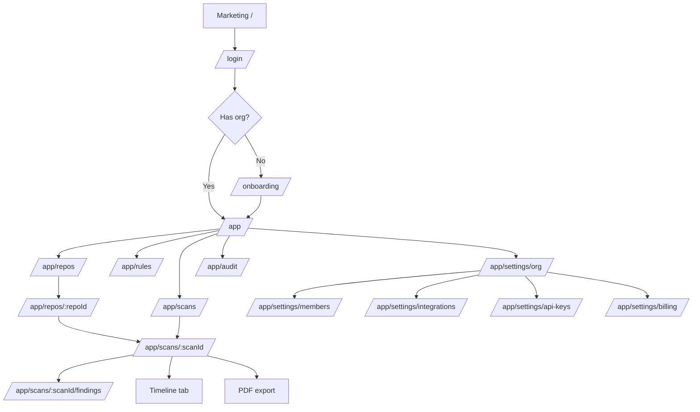

# DPDPA GitHub Code Auditor — Frontend and UI Architecture

| Field | Value |
|---|---|
| Document version | 1.0 |
| Date | 2026-11-04 |
| Framework | Nuxt 4, Vue 3.5, TypeScript, Nuxt UI 3, Tailwind CSS 4 |
| Status | Specification only — no frontend code is implemented by this document |
| Related documents | `PRD.md`, `api.md`, `code_style.md`, `security.md` |

---

## 1. Design intent

The interface is a **compliance workbench**, not a marketing dashboard. It must answer three questions in order:

1. **How exposed are we?** A score, a grade, and the sections driving them.
2. **What exactly is wrong?** A filterable evidence table with file, line, clause, and confidence.
3. **What do I do next?** A specific fix, an owner, and a way to mark progress.

### Principles

- **Evidence before decoration.** The score is never shown without its coverage status and the findings that produce it.
- **Calm urgency.** Critical findings are visually loud, but the page does not use fear-based copy or flashing elements.
- **One primary action per screen.** Start a scan, triage a finding, or export a report — not all three at once.
- **Legible under pressure.** A DPO should understand the page without a tooltip; an engineer should reach the fix in two clicks.
- **Accessible by default.** WCAG 2.1 AA, keyboard-first, no colour-only meaning.
- **No AI aesthetic.** No purple gradients, oversized hero cards, stock card grids, or generic "insights" panels. Use a restrained slate-and-teal palette, dense tables, and clear hierarchy.

---

## 2. Information architecture



### Route map

| Route | Page | Rendering | Auth |
|---|---|---|---|
| `/` | Marketing landing | SSG/ISR | Public |
| `/login` | Sign-in | SSR | Public |
| `/onboarding` | Create org, paste a repository URL | SSR | User without org |
| `/app` | Overview dashboard | SSR + client refresh | Member |
| `/app/repos` | Repository list | SSR | Member |
| `/app/repos/[repoId]` | Repository detail and scan history | SSR | Member |
| `/app/scans` | All scans | SSR | Member |
| `/app/scans/[scanId]` | Scorecard and summary | SSR + polling | Member |
| `/app/scans/[scanId]/findings` | Findings workbench | SSR shell + client table | Member |
| `/app/rules` | DPDPA control catalog | SSR | Member |
| `/app/rules/[code]` | Control detail and mappings | SSR | Member |
| `/app/settings/org` | Org profile and retention | SSR | Admin |
| `/app/settings/members` | Members and roles | SSR | Admin |
| `/app/settings/repositories` | Saved repository URLs | SSR | Admin |
| `/app/settings/api-keys` | API keys | SSR | Owner |
| `/app/settings/billing` | Plan and usage | SSR | Owner |
| `/app/audit` | Audit log | SSR | Admin |
| `/report/[reportId]` | Print-optimised report preview | SSR | Member (signed) |
| `[...slug]` | Not found | SSR | Public |

Redirect rules:

- Unauthenticated `/app/**` → `/login?redirect=<path>`.
- Authenticated user without an org → `/onboarding`.
- Viewer attempting an auditor action → toast + `403` page, not a silent failure.
- Unknown scan/repo ID → `404`, never `403`.

---

## 3. Layouts

### 3.1 `app.vue` — application shell

```
┌────────────────────────────────────────────────────────────┐
│ Topbar: org switcher · global search · help · avatar       │ 56px
├───────────────┬────────────────────────────────────────────┤
│ Sidebar       │ Page header (title, breadcrumb, actions)    │
│ 240px         │                                            │
│               │ Content (max-width 1280px, 24px gutters)    │
│ Overview      │                                            │
│ Repositories  │                                            │
│ Scans         │                                            │
│ Rules         │                                            │
│ Audit         │                                            │
│ Settings      │                                            │
└───────────────┴────────────────────────────────────────────┘
```

- Sidebar collapses to an off-canvas drawer below 1024 px.
- Sidebar shows a plan-usage meter at the bottom (scans used / limit) with an upgrade link.
- Topbar contains the org switcher, a command palette trigger (`⌘K`), and the account menu.
- A skip link (`Skip to content`) is the first focusable element.
- The shell uses `<NuxtLoadingIndicator>` and a route-level error boundary.

### 3.2 `auth.vue` — login and onboarding

- Split layout on desktop: product explanation on the left, action card on the right.
- Single column below 768 px.
- No navigation sidebar; a minimal logo and "Back to site" link.
- Onboarding is a three-step wizard: create organisation → paste a repository URL → review resolved default branch. Each step is resumable.

### 3.3 `print.vue` — report preview

- No sidebar, no topbar.
- A4-width content column (210 mm) with 18 mm margins.
- Print button and "Download PDF" action are hidden in `@media print`.
- Page breaks are explicit (`break-before: page`) before major sections.

---

## 4. Component hierarchy

```
app/components/
├── shell/
│   ├── AppSidebar.vue
│   ├── AppTopbar.vue
│   ├── OrgSwitcher.vue
│   ├── PageHeader.vue
│   ├── PlanUsageMeter.vue
│   └── CommandPalette.vue
├── common/
│   ├── EmptyState.vue
│   ├── ErrorState.vue
│   ├── LoadingSkeleton.vue
│   ├── ConfirmDialog.vue
│   ├── ToastHost.vue
│   ├── CopyButton.vue
│   └── RelativeTime.vue
├── score/
│   ├── ScoreCard.vue
│   ├── ScoreGauge.vue
│   ├── GradeBadge.vue
│   ├── SectionBreakdown.vue
│   ├── CoverageBanner.vue
│   └── ScoreTrend.vue
├── scans/
│   ├── ScanSubmitForm.vue
│   ├── RepoPicker.vue
│   ├── ScanStatusBadge.vue
│   ├── ScanProgress.vue
│   ├── ScanTimeline.vue
│   └── ScanListTable.vue
├── findings/
│   ├── FindingsTable.vue
│   ├── FindingFilters.vue
│   ├── FindingDrawer.vue
│   ├── SeverityBadge.vue
│   ├── ConfidenceBadge.vue
│   ├── FindingStatusBadge.vue
│   ├── EvidenceBlock.vue
│   ├── RemediationPanel.vue
│   ├── TriageForm.vue
│   └── BulkActionBar.vue
├── reports/
│   ├── ReportDownloadButton.vue
│   └── ReportStatus.vue
├── rules/
│   ├── RuleCard.vue
│   ├── RuleMappingTable.vue
│   └── SectionNav.vue
└── settings/
    ├── MemberTable.vue
    ├── RoleSelect.vue
    ├── ApiKeyTable.vue
    ├── CreateApiKeyDialog.vue
    └── AuditLogTable.vue
```

### Containers vs. presentation

- **Page components** (`app/pages/**`) own data fetching and pass plain data down.
- **Container components** (`FindingsWorkbench`, `ScanSummary`) may fetch and coordinate.
- **Presentation components** (`ScoreCard`, `SeverityBadge`) receive props and emit events; no `$fetch`, no store access.
- A component above 200 lines is split. A component with more than seven props is a candidate for slots or composition.

---

## 5. Component specifications

### 5.1 `ScoreCard.vue`

The hero of the scan page. It must never show a score without context.

```ts
interface FindingCounts {
  critical: number
  high: number
  medium: number
  low: number
  info: number
  total: number
}

interface ScoreCardProps {
  score: number | null
  grade: 'A' | 'B' | 'C' | 'D' | 'F' | null
  previousScore?: number | null
  coverage: 'full' | 'partial'
  coverageNote?: string
  counts: FindingCounts
  isLoading?: boolean
}
```

Layout:

```
┌──────────────────────────────────────────────────────────────┐
│  DPDPA score                    [Grade B]    ▲ 4.2 vs last  │
│  82.6 / 100                                                  │
│  ████████████████████████░░░░  (gauge, labelled)            │
│                                                              │
│  Critical 2 · High 7 · Medium 14 · Low 9 · Info 3           │
│  ⚠ Coverage incomplete: Gitleaks timed out. Grade withheld. │
└──────────────────────────────────────────────────────────────┘
```

Rules:

- If `score === null`, show "Not scored" with the reason, not `0`.
- If `grade === null` and coverage is partial, show a `CoverageBanner` directly beneath the gauge.
- The gauge is SVG with `role="img"` and an `aria-label` that includes the score and grade.
- Counts are links to the filtered findings view.
- The trend compares to the previous completed scan of the same repository and commit lineage; if none, show "First scan".
- Loading uses a skeleton with the same dimensions to avoid layout shift.

### 5.2 `SectionBreakdown.vue`

A compact table, not a pie chart.

| Section | Score | Controls failed | Findings | Status |
|---|---|---|---|---|
| 8(4) Security safeguards | 68.2 | 2 of 8 | 12 | Non-compliant |
| 6 Consent | 61.5 | 2 of 4 | 5 | Non-compliant |
| 5 Notice | 85.0 | 1 of 3 | 1 | Partial |
| 16 Cross-border | 100.0 | 0 of 2 | 0 | Compliant |
| 12 Right to access | — | — | — | Not assessed by code |

- Sort by score ascending by default, so the worst section is first.
- Clicking a row filters findings by that section.
- A "Not assessed" row is visually muted and explains why in a tooltip and inline text.
- Score bars use both colour and a numeric label.

### 5.3 `FindingsTable.vue`

```ts
interface FindingsTableProps {
  findings: Finding[]
  total: number
  page: number
  pageSize: number
  sort: SortState
  isLoading?: boolean
  selectedIds?: string[]
}

type SortState = {
  field: 'severity' | 'filePath' | 'lineStart' | 'createdAt'
  direction: 'asc' | 'desc'
}

// emits
'update:page' | 'update:pageSize' | 'update:sort' | 'select' | 'triage'
```

Columns:

| Column | Content | Notes |
|---|---|---|
| Severity | `SeverityBadge` | Icon + label; sortable |
| Control | `DPDPA-8.4-LOG-01` + short title | Links to the rule page |
| Finding | Message, file path, line range | Truncate to two lines |
| Scanner | Semgrep / Checkov / Gitleaks | Icon + text |
| Confidence | Direct / Inferred / Advisory | Tooltip explains |
| Status | Open / Accepted risk / False positive / Fixed | Badge |
| Actions | Triage, open detail | Keyboard accessible |

Behaviour:

- Server-side pagination and sorting. The table never sorts only the current page.
- Row click opens `FindingDrawer`; the row is keyboard-focusable and responds to `Enter`.
- `aria-sort` is set on the sorted column.
- A sticky header and a sticky first column on narrow screens.
- Bulk selection is available only to auditor+; the bulk bar shows the count and allowed actions.
- Empty state: "No findings match these filters" with a "Clear filters" action.
- Loading: skeleton rows, not a spinner over the whole table.
- Error: inline `ErrorState` with request ID and retry.

### 5.4 `FindingDrawer.vue`

A right-side `USlideover`, 560 px wide (full width on mobile).

Sections, in order:

1. **Summary** — severity, control, scanner, file and line, confidence.
2. **Why this matters** — DPDPA clause, obligation, rationale, and the legal disclaimer link.
3. **Evidence** — redacted snippet or, for secrets, "Value withheld for security" plus the hash prefix.
4. **Remediation** — numbered steps, code example, framework-specific guidance, "Copy fix" button.
5. **History** — triage events with actor and timestamp.
6. **Actions** — mark false positive, accept risk, mark fixed, reopen; a note is required where the API requires it.

Accessibility:

- Focus moves to the drawer heading on open and returns to the triggering row on close.
- `Esc` closes; focus is trapped inside.
- The drawer is `aria-labelledby` the finding title.
- The triage form associates errors with fields and announces success via a live region.

### 5.5 `ScanSubmitForm.vue`

- Step 1: paste a GitHub URL (primary field); optionally pick an already-saved repository from the dropdown.
- Step 2: choose a branch or commit; the resolved default branch is preselected.
- Step 3: choose a profile (`standard` or `secrets-only`) and confirm.
- Shows plan usage and disables submit when the quota is exhausted, with an upgrade link.
- Generates an `Idempotency-Key` when the form is first rendered and reuses it across retries.
- On submit, navigates to `/app/scans/[scanId]` and starts polling.
- Validates the URL client-side for format only; the server is authoritative.

### 5.6 `ScanProgress.vue`

- Stages: Queued → Cloning → Scanning → Mapping → Completed.
- Each scanner shows its own status: pending, running, completed, failed, timed out.
- A partial coverage warning appears as soon as a scanner fails, without waiting for the scan to finish.
- Elapsed time is shown, but no fake percentage; progress is stage-based.
- A cancel action is available to auditor+ and requires confirmation.
- `aria-live="polite"` announces stage changes, throttled to avoid noise.

### 5.7 Badges

| Badge | Token | Text | Icon |
|---|---|---|---|
| Critical | `risk-critical` | Critical | Shield alert |
| High | `risk-high` | High | Alert triangle |
| Medium | `risk-medium` | Medium | Alert circle |
| Low | `risk-low` | Low | Info |
| Info | `risk-info` | Info | Circle |
| Compliant | `status-compliant` | Compliant | Check |
| Partial | `status-partial` | Partial | Half circle |
| Non-compliant | `status-non-compliant` | Non-compliant | X |
| Not assessed | `status-na` | Not assessed | Minus |
| Direct | `confidence-direct` | Direct evidence | Target |
| Inferred | `confidence-inferred` | Inferred | Wave |
| Advisory | `confidence-advisory` | Advisory | Lightbulb |

Badges always include text; colour is supplementary.

---

## 6. Design tokens

Tailwind CSS 4 uses CSS-first configuration. Tokens live in `app/assets/css/main.css`.

```css
@import "tailwindcss";
@import "@nuxt/ui";

@theme {
  /* Brand: deep slate with teal accent. No purple. */
  --color-brand-50:  #f0fdfa;
  --color-brand-100: #ccfbf1;
  --color-brand-500: #14b8a6;
  --color-brand-600: #0d9488;
  --color-brand-700: #0f766e;
  --color-brand-900: #134e4a;

  /* Neutrals */
  --color-ink-50:  #f8fafc;
  --color-ink-100: #f1f5f9;
  --color-ink-200: #e2e8f0;
  --color-ink-300: #cbd5e1;
  --color-ink-400: #94a3b8;
  --color-ink-500: #64748b;
  --color-ink-600: #475569;
  --color-ink-700: #334155;
  --color-ink-800: #1e293b;
  --color-ink-900: #0f172a;

  /* Risk scale — background, border, and text are contrast-checked pairs */
  --color-risk-critical-bg:     #fef2f2;
  --color-risk-critical-border: #fecaca;
  --color-risk-critical-text:   #991b1b;
  --color-risk-critical-solid:  #dc2626;

  --color-risk-high-bg:     #fff7ed;
  --color-risk-high-border: #fed7aa;
  --color-risk-high-text:   #9a3412;
  --color-risk-high-solid:  #ea580c;

  --color-risk-medium-bg:     #fffbeb;
  --color-risk-medium-border: #fde68a;
  --color-risk-medium-text:   #92400e;
  --color-risk-medium-solid:  #d97706;

  --color-risk-low-bg:     #f7fee7;
  --color-risk-low-border: #d9f99d;
  --color-risk-low-text:   #3f6212;
  --color-risk-low-solid:  #65a30d;

  --color-risk-info-bg:     #eff6ff;
  --color-risk-info-border: #bfdbfe;
  --color-risk-info-text:   #1e40af;
  --color-risk-info-solid:  #2563eb;

  /* Compliance status */
  --color-status-compliant-bg:     #f0fdf4;
  --color-status-compliant-border: #bbf7d0;
  --color-status-compliant-text:   #166534;
  --color-status-partial-bg:       #fffbeb;
  --color-status-partial-border:   #fde68a;
  --color-status-partial-text:     #92400e;
  --color-status-noncompliant-bg:  #fef2f2;
  --color-status-noncompliant-border: #fecaca;
  --color-status-noncompliant-text:   #991b1b;
  --color-status-na-bg:     #f8fafc;
  --color-status-na-border: #e2e8f0;
  --color-status-na-text:   #475569;

  /* Confidence */
  --color-confidence-direct-bg:   #f0fdf4;
  --color-confidence-direct-text: #166534;
  --color-confidence-inferred-bg: #fffbeb;
  --color-confidence-inferred-text: #92400e;
  --color-confidence-advisory-bg: #f8fafc;
  --color-confidence-advisory-text: #475569;

  /* Typography */
  --font-sans: "Inter", ui-sans-serif, system-ui, -apple-system, "Segoe UI", sans-serif;
  --font-mono: "JetBrains Mono", ui-monospace, "SFMono-Regular", Menlo, monospace;

  /* Radii */
  --radius-control: 0.375rem;  /* 6px  */
  --radius-card:    0.625rem;  /* 10px */
  --radius-pill:    9999px;

  /* Shadows: subtle only */
  --shadow-card: 0 1px 2px 0 rgb(15 23 42 / 0.04);
  --shadow-popover: 0 8px 24px -8px rgb(15 23 42 / 0.18);
}
```

### 6.1 Semantic utility usage

| Purpose | Class |
|---|---|
| Primary button | `bg-brand-700 hover:bg-brand-600 text-white` |
| Page background | `bg-ink-50` |
| Card | `bg-white border border-ink-200 rounded-[var(--radius-card)] shadow-[var(--shadow-card)]` |
| Muted text | `text-ink-500` |
| Body text | `text-ink-800` |
| Critical badge | `bg-risk-critical-bg text-risk-critical-text border-risk-critical-border` |
| Compliant badge | `bg-status-compliant-bg text-status-compliant-text border-status-compliant-border` |
| Focus ring | `focus-visible:outline-none focus-visible:ring-2 focus-visible:ring-brand-500 focus-visible:ring-offset-2` |

### 6.2 Typography scale

| Token | Size / line height | Use |
|---|---|---|
| `text-xs` | 12 / 16 | Metadata, table captions |
| `text-sm` | 14 / 20 | Table body, labels |
| `text-base` | 16 / 24 | Body |
| `text-lg` | 18 / 28 | Card titles |
| `text-xl` | 20 / 28 | Section titles |
| `text-2xl` | 24 / 32 | Page titles |
| `text-4xl` | 36 / 40 | Score number only |

Do not skip heading levels. The page has exactly one `h1`.

### 6.3 Spacing and radii

- Spacing follows the 4 px scale: 1, 2, 3, 4, 6, 8, 12, 16, 24.
- Cards use 16–24 px padding; tables use 12 px cell padding.
- Controls use 6 px radius; cards 10 px; badges and avatars are pills.
- No arbitrary pixel values. No `rounded-2xl` everywhere.

### 6.4 Dark mode

Dark mode is post-MVP. The token structure supports it by overriding semantic variables under `.dark`. Risk tokens must be re-checked for contrast before shipping.

---

## 7. State management

### 7.1 The decision rule

| State | Tool | Example |
|---|---|---|
| Server data | `useFetch` / `useAsyncData` | Scan detail, findings page |
| Session and org context | `useState` + `useUserSession` | Active org, role, feature flags |
| URL state | route query | Filters, pagination, sort, selected tab |
| Local component state | `ref` / `reactive` | Drawer open, form draft |
| Cross-page client state | Pinia | Scan wizard, bulk selection, table preferences |

**Server data never goes into Pinia.** Duplicating it creates stale views and invalidation bugs.

### 7.2 Server data

```ts
// app/pages/app/scans/[scanId].vue
const route = useRoute()
const scanId = computed(() => route.params.scanId as string)

const { data: scan, status, error, refresh } = await useFetch<ScanDetail>(
  () => `/api/v1/scan/${scanId.value}`,
  {
    key: `scan:${scanId.value}`,
    headers: useRequestHeaders(['cookie']),
    watch: [scanId],
  },
)
```

Rules:

- Forward cookies during SSR with `useRequestHeaders(['cookie'])`.
- Use a stable `key` so navigation and hydration match.
- Use `lazy: true` only for below-the-fold data.
- Use `transform` to map API shapes to view models; do not mutate raw responses.
- Errors are handled with `error.value` and rendered by `ErrorState`; never swallowed.

### 7.3 Polling

```ts
// app/composables/useScanPolling.ts
export function useScanPolling(scanId: Ref<string>) {
  const interval = ref(2000)
  const isVisible = useDocumentVisibility()
  let timer: ReturnType<typeof setTimeout> | undefined

  const { data, refresh, status } = useFetch<ScanDetail>(
    () => `/api/v1/scan/${scanId.value}`,
    { key: `scan-poll:${scanId.value}`, headers: useRequestHeaders(['cookie']) },
  )

  const isTerminal = computed(() =>
    ['completed', 'failed', 'cancelled', 'expired'].includes(data.value?.status ?? ''),
  )

  async function tick() {
    if (isTerminal.value || isVisible.value === 'hidden') return
    await refresh()
    interval.value = Math.min(interval.value * 1.2, 10000)
    timer = setTimeout(tick, interval.value)
  }

  onMounted(() => { timer = setTimeout(tick, interval.value) })
  onUnmounted(() => { if (timer) clearTimeout(timer) })
  watch(isVisible, (v) => { if (v === 'visible' && !isTerminal.value) tick() })

  return { data, status, refresh, isTerminal }
}
```

- 2 s cadence, backing off to 10 s, stops on terminal status.
- Pauses when the tab is hidden; resumes on focus.
- No polling during SSR; the initial request is server-rendered.
- Polling errors are shown inline after three consecutive failures, with a manual retry.

### 7.4 URL state

Filters, pagination, sort, and the active tab are encoded in the query string so a DPO can share a view.

```ts
const filters = computed({
  get: () => ({
    severity: route.query.severity ?? [],
    scanner: route.query.scanner ?? [],
    section: route.query.section ?? [],
    status: route.query.status ?? [],
    q: (route.query.q as string) ?? '',
    page: Number(route.query.page ?? 1),
  }),
  set: (next) => router.replace({ query: serialiseFilters(next) }),
})
```

Debounce text search by 300 ms. Do not push history entries for every keystroke; use `replace`.

### 7.5 Pinia stores

| Store | State | Persistence |
|---|---|---|
| `useScanWizardStore` | Step, repository, ref, profile, idempotency key | `sessionStorage` |
| `useFindingsSelectionStore` | Selected finding IDs, bulk action state | In-memory |
| `usePreferencesStore` | Table density, visible columns, theme | `localStorage` |

No store holds server entities. A store may hold IDs and UI choices.

### 7.6 `useState` keys

| Key | Shape | Scope |
|---|---|---|
| `org` | `{ id, name, slug, plan, role, retentionDays }` | App-wide |
| `features` | `Record<string, boolean>` | App-wide |
| `commandPaletteOpen` | `boolean` | App-wide |
| `lastScanId` | `string \| null` | Session |

Use `useState` for SSR-safe shared state; it serialises to the payload and avoids cross-request leakage.

---

## 8. Loading, empty, error, and permission states

Every data surface defines all five states.

| State | Pattern |
|---|---|
| Loading | Skeleton matching final layout; `aria-busy="true"`; no full-page spinner |
| Empty | Icon, one-sentence explanation, primary action; never a blank panel |
| Error | Inline `ErrorState` with a plain message, request ID, retry button; no stack trace |
| Partial | `CoverageBanner` naming the failed scanner and what is missing |
| Permission | Role-appropriate read-only view; actions disabled with a tooltip explaining the required role |
| Success | Toast for mutations; inline confirmation for destructive actions |

Examples:

- **Dashboard, no repositories:** "Connect your first repository to see a DPDPA score." → `Connect repository`.
- **Findings, no matches:** "No findings match these filters." → `Clear filters`.
- **Scan failed:** "The scan could not complete. GitHub timed out while cloning." → `Retry scan` + request ID.
- **Report not ready:** "Your PDF is being prepared." → auto-refresh + `Notify me` (post-MVP).

---

## 9. Accessibility

Target: WCAG 2.1 AA.

- Semantic landmarks: `header`, `nav`, `main`, `aside`, `footer`.
- Skip link to `#main`.
- One `h1` per page; headings in order.
- All interactive elements are native `button`, `a`, `input`, `select`, or Nuxt UI equivalents with correct roles.
- Visible focus ring on every focusable element; never `outline: none` without a replacement.
- Focus management for slideover, modal, and route changes.
- Tables: `<caption>`, `<th scope="col">`, `aria-sort`, and a text alternative for row actions.
- Badges include text, not colour alone.
- Charts and gauges have text summaries and `aria-label`.
- Form fields have visible labels, `aria-describedby` for help and errors, and errors announced in a live region.
- Colour contrast: 4.5:1 for body text, 3:1 for large text and UI boundaries.
- `prefers-reduced-motion` disables non-essential transitions.
- Keyboard shortcuts are documented and do not conflict with screen readers.
- Scan status updates use `aria-live="polite"` and are throttled.

Verification:

- `axe-core` in component tests and Playwright.
- Keyboard-only walkthrough of submit → scan → triage → export.
- Screen-reader spot check with NVDA or VoiceOver before each major release.

---

## 10. Responsive behaviour

| Breakpoint | Layout |
|---|---|
| `< 640` | Single column; sidebar becomes a drawer; filters become a bottom sheet; table becomes stacked cards |
| `640–1023` | Two-column content where useful; sidebar drawer; table scrolls horizontally with sticky first column |
| `1024–1439` | Sidebar visible (240 px); content max 1280 px |
| `≥ 1440` | Same as above with wider gutters; no additional density changes |

Test at 320, 768, 1024, and 1440 px. The primary workspace is desktop; mobile supports review and triage, not bulk operations.

---

## 11. Performance budgets

| Metric | Budget |
|---|---|
| LCP (dashboard) | < 2.5 s on a mid-tier laptop, warm cache |
| INP | < 200 ms |
| CLS | < 0.1 |
| Initial JS for `/app` | < 180 KB gzipped |
| Findings table interaction | < 100 ms per page change |
| Route transition | < 300 ms perceived |

Techniques:

- SSR the dashboard and scan summary; stream below-the-fold sections.
- Lazy-load `FindingDrawer`, charts, and the command palette.
- Server-side pagination; never load 1,000 findings to filter in the browser.
- Use `NuxtImg` for avatars; no large hero images in the app.
- Avoid moment.js and heavy chart libraries; use a small SVG sparkline.
- Prefetch the next likely route on hover.
- Bundle analysis in CI with a 10% regression threshold.

---

## 12. PDF report design

The PDF is a separate render target, not a screenshot of the app.

### Structure (maximum 12 pages)

1. **Cover** — organisation, repository, commit, scan date, report ID, classification ("Confidential").
2. **Executive summary** — score, grade, coverage, three key risks, three recommended actions.
3. **Score breakdown** — section table with scores, failed controls, and trend.
4. **Top findings** — maximum 20, ordered by severity and control weight; each with file, line, clause, and fix.
5. **Remediation plan** — grouped by owner or sprint; quick wins vs. structural fixes.
6. **Methodology** — scanners, versions, rule pack, scoring formula, coverage, limitations.
7. **Appendix** — full finding index, control catalog, glossary, disclaimer.

### Visual rules

- A4 portrait, 18 mm margins, 10 pt body, 8 pt tables.
- Same risk tokens as the app; every colour has a text label.
- Header on each page: repository name and scan date. Footer: page number and "Not legal advice".
- Page breaks before major sections; no orphan headings; no table row split across pages.
- Fonts embedded; no remote assets; no JavaScript; no interactive elements.
- Links are shown with visible URLs in the appendix.
- The PDF is generated from the same view model as the dashboard, so numbers cannot diverge.
- Secret values are never rendered; secret findings show "Value withheld".

### Accessibility

Puppeteer does not produce a fully tagged PDF. Until a tagged-PDF pipeline exists, the report ships with:

- A logical reading order in the HTML source.
- Sufficient contrast and font size.
- A plain-text summary section.
- An HTML preview route (`/report/[reportId]`) that is fully accessible and is the primary accessible format.

---

## 13. Copy and tone

- Direct, specific, and calm.
- Say what is known and what is not: "No findings were detected by the configured scanners" rather than "No issues".
- Never claim legal compliance.
- Use "finding", "control", "section", and "remediation" consistently.
- Avoid "leverage", "seamless", "revolutionary", "AI-powered".
- Error messages say what happened, what to do, and include a request ID.
- Button labels are verbs: "Start scan", "Export PDF", "Mark as fixed".

### Microcopy examples

| Context | Copy |
|---|---|
| Empty dashboard | "Connect a repository to see your first DPDPA score." |
| Partial coverage | "Gitleaks timed out. Secret findings may be missing, so the grade is withheld." |
| Advisory finding | "This is a hygiene signal, not a confirmed legal gap." |
| Accepted risk | "You accepted this risk. It still counts toward the score until it is fixed." |
| Report disclaimer | "This report provides technical evidence, not legal advice." |

---

## 14. Anti-patterns

- Purple or indigo gradients; glassmorphism; neon accents.
- Oversized rounded cards with equal padding for every section.
- A gauge with no numeric score or no coverage status.
- Colour-only severity (red/green dot with no label).
- Client-side filtering of a full findings dump.
- Storing server data in Pinia.
- Full-page spinners.
- A "100% compliant" celebratory state.
- Charts that cannot be read without hover.
- Hidden actions that appear only on row hover without keyboard access.
- Modal dialogs for primary navigation.
- Fake progress percentages during a scan.

---

## 15. Definition of done for a UI feature

- [ ] All five states implemented: loading, empty, error, partial, permission.
- [ ] Keyboard-only path works end to end.
- [ ] `axe-core` reports no serious or critical issues.
- [ ] Responsive at 320, 768, 1024, 1440 px.
- [ ] Copy reviewed against §13.
- [ ] No raw hex values outside the token file.
- [ ] No server data in Pinia.
- [ ] Bundle budget respected.
- [ ] Playwright test covers the primary journey.
- [ ] Screenshot or recording attached to the PR.
