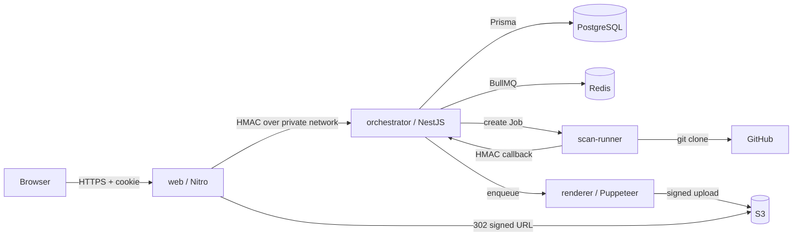

# DPDPA GitHub Code Auditor — AI Memory

| Field | Value |
|---|---|
| Purpose | Persistent context for AI assistants and new engineers working on this repository |
| Document version | 1.0 |
| Date | 2026-11-04 |
| Status | Authoritative for conventions; subordinate to `PRD.md` for scope |
| Update rule | Update this file in the same PR that changes a convention, pin, or invariant |

---

## 1. Read these first

Read in this order before writing code or proposing a design:

| Order | File | Why |
|---|---|---|
| 1 | `PRD.md` | Scope, personas, non-goals, success metrics |
| 2 | `architecture.md` | Service boundaries, scan lifecycle, ADRs |
| 3 | `database.md` | Schema, enums, indexes, retention |
| 4 | `api.md` | Public and internal contracts, error codes |
| 5 | `security.md` | Threat model, isolation, `nuxt-security`, incident response |
| 6 | `rules.md` | Control catalog, mapping, scoring formula, approved language |
| 7 | `design.md` | Routes, components, tokens, states, accessibility |
| 8 | `code_style.md` | TypeScript, Vue, NestJS, Prisma, testing, git |
| 9 | `tasks.md` | Phases, dependencies, definition of done, gates |
| 10 | `memory.md` | This file: the fast reference |

If two documents disagree, the earlier document in this list wins for its domain, except that `memory.md` wins on naming and pins. Report the conflict rather than guessing.

---

## 2. What this product is

A B2B SaaS that audits GitHub repositories for DPDPA (India, 2023) exposure. It clones a repo into an ephemeral Kubernetes Job, runs Semgrep, Checkov, and Gitleaks, maps findings to DPDPA obligations, scores the repository, and produces a PDF report.

**One-line:** Find DPDPA exposure in your repositories before it reaches production — with evidence, clause mapping, and fix guidance.

**It is not:** legal advice, a compliance certification, a runtime cloud scanner, or a store of customer source code.

---

## 3. Hard invariants

These are non-negotiable. A change that violates one is rejected, not debated.

1. **Source code is never persisted.** It exists only in the scan pod's `emptyDir` and in process memory. Not in Postgres, Redis, S3, logs, traces, or backups.
2. **Nitro is the only public HTTP surface.** The orchestrator and renderer are private.
3. **Only the orchestrator writes to PostgreSQL.** Nitro never opens a database connection.
4. **Every tenant query filters on `org_id`.** The org comes from the verified session or API key, never from the request body or query.
5. **Scores are deterministic.** Same findings + rule pack + scoring version ⇒ same score. No clock, randomness, or network in scoring code.
6. **Historical scores are never silently rewritten.** A rule-pack upgrade does not change past scans.
7. **Partial coverage withholds the grade.** A scan with a failed scanner is `provisional`, never "clean".
8. **Secrets are never displayed or logged.** Only a rule ID, file, line, salted hash, and at most a 4-character prefix.
9. **Cross-tenant access returns 404, not 403**, to avoid existence leaks.
10. **Rule and mapping changes require a version bump and legal review.**
11. **No `v-html` with user, scanner, or API content.**
12. **No `$queryRawUnsafe` or `$executeRawUnsafe`.**
13. **No secrets in source, tests, fixtures, or comments.** Fixtures use obviously fake values.
14. **Scanner images and versions are pinned by digest/version.** No floating tags.
15. **Audit logs are append-only.** The runtime DB role has no `UPDATE`/`DELETE` on them.
16. **Repository access is URL-only and anonymous.** Only `https://github.com/<owner>/<repo>` public repositories; no redirects, `GIT_TERMINAL_PROMPT=0`, no GitHub credentials anywhere (ADR-011).

---

## 4. Stack pins

| Area | Pin |
|---|---|
| Node.js | 22 LTS |
| Package manager | pnpm 9, committed lockfile, `--frozen-lockfile` in CI |
| Monorepo | Turborepo |
| TypeScript | 5.6+, `strict`, `noUncheckedIndexedAccess`, `exactOptionalPropertyTypes` |
| Frontend | Nuxt 4, Vue 3.5, Nuxt UI 3, Tailwind CSS 4 |
| Auth (web) | `nuxt-auth-utils` sealed cookie |
| Security (web) | `nuxt-security@^2` |
| Backend | NestJS 10 + Fastify |
| ORM | Prisma 5 |
| Database | PostgreSQL 16 (pgcrypto, citext) |
| Queue | BullMQ 5 + Redis 7 |
| Validation | Zod 3 via `packages/contracts` |
| PDF | Puppeteer in a dedicated `renderer` deployment |
| Tests | Vitest, `@nuxt/test-utils`, Playwright, Testcontainers |
| Logging | Pino, JSON, redaction allowlist |
| Tracing | OpenTelemetry (W3C `traceparent`) |
| Scanners | Semgrep 1.95.x, Checkov 3.2.x, Gitleaks 8.21.x (pinned) |
| Runtime isolation | Kubernetes Jobs, gVisor `RuntimeClass`, UID 10001 |

Version changes arrive as Renovate PRs, never as opportunistic edits.

---

## 5. Canonical vocabulary

Use these terms exactly. Do not invent synonyms.

| Term | Meaning |
|---|---|
| **Scan** | One execution of the scanner suite against one repository ref |
| **Finding** | One persisted detection, mapped to at most one control, with a fingerprint |
| **Control** | A specific assessable obligation (`dpdpa_rules`), code `DPDPA-<section>-<domain>-<seq>` |
| **Section** | A DPDPA section: `5`, `6`, `7`, `8(4)`, `8(5)`, `9`, `10`, `12`, `13`, `16` |
| **Mapping** | A rule joining a scanner rule ID to a control, with confidence and rationale |
| **Coverage** | Which scanners actually completed; `full` or `partial` |
| **Score** | Weighted section aggregate, 0–100, two decimals |
| **Grade** | A/B/C/D/F; `null` when coverage is partial |
| **Triage** | A human status change on a finding |
| **Evidence group** | Findings sharing `(filePath, lineStart, controlCode)` for display |
| **Rule pack** | Versioned, signed bundle of controls, mappings, suppressions, and scoring config |
| **Ephemeral scan** | A scan whose pod, workspace, and secrets are destroyed on completion |

---

## 6. Canonical enums

Copy these exactly. Wire values are lowercase snake_case; database enums mirror them.

```ts
// scan status
'queued' | 'cloning' | 'scanning' | 'mapping'
| 'completed' | 'failed' | 'cancelled' | 'expired'

// scan trigger (MVP; 'scheduled' | 'webhook' post-MVP with the GitHub App)
'manual' | 'api'

// severity
'critical' | 'high' | 'medium' | 'low' | 'info'

// finding status
'open' | 'false_positive' | 'accepted_risk' | 'fixed' | 'reopened'

// mapping confidence
'direct' | 'inferred' | 'advisory'

// scanner
'semgrep' | 'checkov' | 'gitleaks'

// scanner status
'pending' | 'running' | 'completed' | 'failed' | 'timed_out' | 'skipped'

// report status
'queued' | 'rendering' | 'ready' | 'failed' | 'expired'

// role
'owner' | 'admin' | 'auditor' | 'viewer'

// plan
'free' | 'starter' | 'growth' | 'enterprise'
```

### Severity ordering

`critical (5) > high (4) > medium (3) > low (2) > info (1)`

Persisted severity = max(scanner severity, control severity).

---

## 7. ID prefixes

Public APIs expose opaque prefixed IDs. Internally they resolve to UUIDs.

| Prefix | Entity | Example |
|---|---|---|
| `org_` | Organisation | `org_01J8Z2...` |
| `usr_` | User | `usr_01J8...` |
| `repo_` | Repository | `repo_01J8Z3K4...` |
| `scn_` | Scan | `scn_01J8Z4A1...` |
| `fnd_` | Finding | `fnd_01J8Z5B2...` |
| `rpt_` | Report | `rpt_01J8Z6C3...` |
| `key_` | API key | `key_01J8Z7...` |
| `req_` | Request ID | `req_01J8Z4A1...` |
| `bat_` | Runner batch | `bat_01J8Z5...` |
| `fpt_` | Fingerprint | `fpt_9a8b7c...` |

Never expose a raw UUID in a public payload. Never accept a prefixed ID as a UUID without resolving it.

---

## 8. Core tables

| Table | Purpose | Tenant key |
|---|---|---|
| `organizations` | Tenant root, plan, retention, region | `id` |
| `users` | Identity | — |
| `memberships` | `(org_id, user_id)` → role, status | `org_id` |
| `sessions` | Server-side sessions: absolute/idle expiry, revocation | — |
| `repositories` | Saved public repo URLs, soft delete | `org_id` |
| `api_keys` | Hashed keys with scopes | `org_id` |
| `scans` | Lifecycle, score, coverage, versions | `org_id` |
| `scan_events` | Append-only timeline | `org_id` |
| `dpdpa_rules` | Control catalog | — |
| `rule_mappings` | Scanner rule → control | — |
| `scanner_findings` | Persisted findings | `org_id` |
| `remediation_logs` | Append-only triage history | `org_id` |
| `reports` | PDF metadata, storage key | `org_id` |
| `audit_logs` | Append-only security events | `org_id` |
| `usage_events` | Billing and cost metering | `org_id` |

Full DDL is in `database.md`. Do not hand-edit migrations outside Prisma unless it is a concurrent index or enum change.

---

## 9. Architecture boundaries



| Component | May | Must not |
|---|---|---|
| `web` | SSR, sessions, validation, rate limits, proxy, redirect to signed URL | Touch Postgres, hold GitHub credentials, run scanners, render PDFs |
| `orchestrator` | Domain logic, Prisma, scoring, queues, Jobs, callbacks | Serve public traffic, clone code, render PDFs |
| `scan-runner` | Clone, scan, normalise, redact, callback | Persist code, reach the DB, call arbitrary hosts |
| `renderer` | Fetch view model, render HTML → PDF, upload | Read source, mutate scan data, load remote assets |

**Internal auth:** `X-Internal-Key` + `X-Internal-Signature` = HMAC-SHA256(secret, `timestamp + "." + rawBody`), 300 s skew. Runner callbacks use a per-scan HMAC only — no service-account token, no TokenReview (would need cluster-wide RBAC; ADR-001/§15 of architecture.md).

---

## 10. Scan lifecycle

```
queued → cloning → scanning → mapping → completed
                              ↘ failed
        ↘ cancelled
        ↘ expired (retention)
```

| Stage | Owner | What happens |
|---|---|---|
| `queued` | Orchestrator | Row created; BullMQ job enqueued |
| `cloning` | Runner | Secret + Job created; `git clone --depth 1` |
| `scanning` | Runner | Semgrep → Checkov → Gitleaks; batched callbacks |
| `mapping` | Orchestrator | Resolve mappings, fan out, score, persist rollups |
| `completed` | Orchestrator | Terminal; grade set if coverage is full |
| `failed` | Orchestrator | Terminal; `error_code` + `error_message` |
| `cancelled` | Orchestrator | Job and Secret deleted; late callbacks rejected |
| `expired` | Retention | Marked before hard delete |

**Rules:**
- URL is validated and the default branch resolved anonymously (`git ls-remote`) before the row enters `queued`.
- One active scan per `(repository_id, ref)`.
- Same `(org_id, idempotency_key)` returns the original scan.
- A missing callback with a successful Job ⇒ `INCOMPLETE_RESULTS`, never a clean score.
- Cancellation tolerates `SIGTERM` for 30 s.

---

## 11. Scoring (memorise this)

```
sectionScore = 100 × (1 − failedWeight / applicableWeight)
```

- `applicableWeight` = Σ weights of controls applicable to this repository.
- `failedWeight` = Σ weights of applicable controls with ≥ 1 open finding.
- `applicableWeight = 0` ⇒ section is `null` ("not assessed"), **not 100**.

```
sectionWeights = {
  "8(4)": 30, "6": 20, "5": 10, "7": 10, "9": 10,
  "10": 5, "13": 5, "8(5)": 5, "16": 5
}

overall = Σ(sectionScore × weight) / Σ(weight of assessed sections)
```

Sections `12`, `14`, `15` have weight 0 and are reported as "Not assessed by code".

| Grade | Range |
|---|---|
| A | 90.00–100.00 |
| B | 80.00–89.99 |
| C | 70.00–79.99 |
| D | 60.00–69.99 |
| F | 0.00–59.99 |

**Triage semantics:**
- `false_positive` → excluded from the score.
- `fixed` → excluded from the score.
- `accepted_risk` → **still counts** as a failure; labelled separately.
- `open`, `reopened` → counts.

**Coverage:** any scanner not `completed` ⇒ coverage `partial` ⇒ `grade = null`, score is provisional, banner shown.

**Worked check (must hold):** Section 8(4) with failed weights 5+8+7+2 = 22 out of 42 ⇒ `100 × (1 − 22/42) = 47.62`.

---

## 12. Rule packs

Location: `packages/rule-packs/`

```
dpdpa-controls.yaml       # controls, severity, weight, appliesWhen, remediation
scoring.yaml              # section weights and formula version
mappings/
  checkov.yaml
  semgrep.yaml
  gitleaks.yaml
suppressions.yaml
CHANGELOG.md
```

Control code format: `DPDPA-<section>-<domain>-<sequence>` — e.g. `DPDPA-8.4-ENC-01`.

Lifecycle: `DRAFT → LEGAL REVIEW → APPROVED → PUBLISHED → DEPRECATED`.

Version bumps:
- patch: wording clarification, no score impact
- minor: new control or mapping
- major: weight, section weight, or formula change

Resolution order: exact `(scanner, ruleId, version)` wins; otherwise `*`; otherwise unmapped. Fan out one finding per control, dedupe by control code.

---

## 13. Fingerprints

```
base = sha256(scanner | scannerRuleId | normalisedPath | snippetHash | occurrenceIndex)
fingerprint = controlCode ? `${base}:${controlCode}` : base
```

- Line numbers are excluded so findings survive code movement.
- `snippetHash` is computed in the runner; the snippet is discarded.
- `occurrenceIndex` disambiguates identical matches in one file.
- Renames produce new fingerprints and are labelled `new`, never guessed as a rename.

---

## 14. API quick reference

Public base: `/api/v1`. Internal: `/internal/v1` (HMAC).

| Method | Path | Role |
|---|---|---|
| GET | `/api/v1/me` | session |
| GET/PATCH | `/api/v1/org` | member / admin |
| GET/POST | `/api/v1/org/members` | member / admin |
| PATCH/DELETE | `/api/v1/org/members/:userId` | admin |
| GET | `/api/v1/repos` | member |
| POST | `/api/v1/repos` | admin |
| POST | `/api/v1/repos/resolve` | auditor+ |
| DELETE | `/api/v1/repos/:repoId` | admin |
| GET | `/api/v1/repos/:repoId/scans` | member |
| POST | `/api/v1/scan` | auditor+ |
| GET | `/api/v1/scan/:scanId` | member |
| POST | `/api/v1/scan/:scanId/cancel` | auditor+ |
| GET | `/api/v1/scan/:scanId/findings` | member |
| GET | `/api/v1/scan/:scanId/events` | member |
| PATCH | `/api/v1/findings/:findingId` | auditor+ |
| POST | `/api/v1/report/pdf` | auditor+ |
| GET | `/api/v1/report/pdf/:reportId` | member |
| GET | `/api/v1/report/pdf/:reportId/download` | member |
| GET | `/api/v1/rules`, `/api/v1/rules/:code` | member |
| GET | `/api/v1/audit-logs` | admin |
| GET/POST/DELETE | `/api/v1/api-keys` | owner |

Response shapes: `{ data }`, `{ data, pagination }`, `{ data, meta }`. Errors: `{ error: { code, message, details?, requestId } }`.

Idempotency: `POST /scan` and `POST /report/pdf` require `Idempotency-Key` for API clients, retained 7 days, scoped `(org_id, key)`.

---

## 15. Error codes

`VALIDATION_ERROR`, `UNAUTHENTICATED`, `FORBIDDEN`, `NOT_FOUND`, `CONFLICT`,
`INVALID_STATE_TRANSITION`, `LAST_OWNER`, `REPO_ALREADY_CONNECTED`,
`SCAN_IN_PROGRESS`, `SCAN_NOT_READY`, `REPORT_NOT_READY`, `REPORT_EXPIRED`,
`IDEMPOTENCY_CONFLICT`, `PLAN_LIMIT_EXCEEDED`, `REPO_NOT_FOUND`,
`REPO_NOT_ACCESSIBLE`, `REPO_TOO_LARGE`, `PAGINATION_LIMIT`, `RATE_LIMITED`,
`PAYLOAD_TOO_LARGE`, `UPSTREAM_UNAVAILABLE`, `INTERNAL_ERROR`.

Codes are stable; messages are not part of the contract. Never add a new code without updating `packages/contracts`.

---

## 16. Forbidden patterns

The following are review blockers. Do not write them.

| Forbidden | Use instead |
|---|---|
| `any` | `unknown` + schema parse, or a precise type |
| `@ts-ignore` | `@ts-expect-error` with a reason comment |
| `!` non-null assertion without an invariant comment | Early return + narrowing |
| `$queryRawUnsafe`, `$executeRawUnsafe` | `$queryRaw` tagged template with parameters |
| `v-html` with untrusted content | Interpolation or a sanitised, allowlisted renderer |
| `innerHTML` | Text nodes / DOM APIs |
| `eval`, `new Function` | Static dispatch |
| `shell=True` in Python | `subprocess.run([...])` |
| String-concatenated SQL/shell/HTML | Parameter binding |
| `console.log` | Pino logger |
| Secrets in code, tests, fixtures, comments | Fake values marked `test-only-not-a-real-key` |
| Server data in Pinia | `useFetch` / `useAsyncData` |
| Postgres from Nitro | Call the orchestrator |
| Trusting `X-Org-Id` / `X-User-Id` from a browser | Derive from session/API key |
| Omitting `org_id` in a tenant query | Always scope |
| Floating `latest` image tags | Digest pin |
| Mocking the module under test | Mock at the network boundary (`msw`) |
| Snapshot tests for scoring | Explicit expected values |
| Retrying a flaky test into green | Quarantine with owner + date |
| Storing code, diffs, or secret values | Redact at source |
| Logging request bodies for scan/triage/auth | Log metadata only |

---

## 17. Commands

```bash
# install and run
pnpm install
pnpm dev                      # all workspaces
docker compose up -d          # local Postgres, Redis, MinIO, Mailpit
kind create cluster --config infra/k8s/kind.yaml   # local Jobs

# quality
pnpm lint
pnpm typecheck
pnpm test:unit
pnpm test:integration
pnpm test:e2e
pnpm format:check

# security
pnpm security:audit
pnpm security:secrets
trivy image <image>
cosign verify <image>

# database
pnpm db:migrate               # local only
pnpm db:deploy                # CI / production
pnpm db:seed                  # never in production

# python adapters
ruff check . && ruff format --check . && mypy --strict . && pytest -q

# single test
pnpm --filter orchestrator test -- src/modules/scoring
pnpm --filter web exec playwright test --project=chromium -g "triage"
```

---

## 18. Repository layout

```
dpdpa-auditor/
├── apps/
│   ├── web/            # Nuxt 4: app/, server/, shared/
│   ├── orchestrator/   # NestJS: src/modules, src/queue, prisma/
│   ├── renderer/       # Fastify + Puppeteer
│   └── scan-runner/    # Dockerfile, entrypoint, adapters
├── packages/
│   ├── contracts/      # Zod schemas, types, error codes
│   ├── rule-packs/     # YAML controls, mappings, suppressions
│   └── config/         # ESLint, TS, Tailwind presets
├── infra/
│   ├── helm/
│   ├── k8s/            # namespaces, network policies, job templates
│   └── terraform/
├── tests/
│   ├── golden-repos/
│   ├── e2e/
│   └── load/
└── docs/
```

---

## 19. Naming conventions

| Element | Convention | Example |
|---|---|---|
| Vue component file | PascalCase | `FindingsTable.vue` |
| Page file | kebab-case, dynamic in brackets | `[scanId].vue` |
| Composable | `use` + camelCase | `useScanPolling.ts` |
| Store | `useXStore` | `useScanWizardStore.ts` |
| Server route | method suffix | `scan.post.ts` |
| Type | PascalCase, no `I` prefix | `ScanDetail` |
| Function | camelCase verb | `computeSectionScore` |
| Boolean | `is`/`has`/`can`/`should` | `isPartial` |
| Constant | UPPER_SNAKE | `MAX_PAGE_SIZE` |
| DB table/column | snake_case | `scanner_findings`, `org_id` |
| Prisma model/field | PascalCase/camelCase + `@map` | `ScannerFinding`, `orgId` |
| Wire enum | lowercase snake_case | `"false_positive"` |
| CSS token | kebab-case | `--color-risk-critical-text` |
| Env var | UPPER_SNAKE | `ORCHESTRATOR_HMAC_KEY` |
| Branch | `feat/`, `fix/`, `chore/`, `docs/` | `feat/scan-cancel` |
| Commit | Conventional Commits | `feat(scans): add cancel endpoint` |

---

## 20. UI state rules

| State | Tool |
|---|---|
| Server data | `useFetch` / `useAsyncData` |
| Session/org context | `useState` + `useUserSession` |
| Filters, pagination, sort, tab | Route query (shareable) |
| Local UI | `ref` / `reactive` |
| Cross-page client state | Pinia (IDs and choices only) |

- Always pass `headers: useRequestHeaders(['cookie'])` during SSR.
- Always pass a stable `key` when the URL depends on a parameter.
- Polling: 2 s → backoff to 10 s, pause when hidden, stop on terminal status.
- Every data surface implements loading, empty, error, partial, and permission states.
- Never show a score without coverage status.
- Badges always include text; colour is supplementary.

---

## 21. Report language rules

Approved language is a legal requirement, not a style preference.

| Never write | Write instead |
|---|---|
| "You are DPDPA compliant" | "The repository shows evidence of these safeguards; this is not a certification" |
| "This violates Section 8" | "This finding maps to Section 8(4) and indicates a potential safeguard gap" |
| "No issues found" | "No findings were detected by the configured scanners; this is not proof of absence" |
| "Data was breached" | "Credential material was detected in the repository" |
| "Illegal cross-border transfer" | "Cross-region replication was detected; confirm the transfer basis with counsel" |
| "100% compliant" | "Sections assessed by code show no detected gaps" |

Every report includes: "This report provides technical evidence, not legal advice."

---

## 22. Useful facts and gotchas

- **`NULL` idempotency keys** are distinct in PostgreSQL, so UI scans without a key do not collide. API clients must send one.
- **`commit_sha`** accepts SHA-1 (40 hex) or SHA-256 (64 hex) object IDs.
- **`citext`** requires the extension; Prisma needs a raw migration for it.
- **RLS** uses `current_setting('app.current_org', true)::uuid`. The runtime role must not bypass RLS; the migration role does.
- **Job Secret ordering:** create the Secret first with a deterministic name, then the Job with `envFrom`; delete the Secret if Job creation fails. Add a cleanup finalizer.
- **`emptyDir` is deleted with the pod**, which is why zero-retention is structural rather than a cron.
- **Cancellation** must delete both Job and Secret and reject late callbacks.
- **Gitleaks findings** never include the matched value; only rule, file, line, hash, and a short prefix.
- **Checkov** emits both JSON and SARIF across versions; the adapter must handle the pinned version only and fail loudly on drift.
- **Applicability** is evaluated before scoring; an inapplicable control is excluded from numerator and denominator.
- **Advisory controls** are excluded from the score unless explicitly `scored: true`.
- **Rounding** is half-up to two decimals, not banker's rounding.
- **PDF** uses the same view model as the dashboard, so numbers cannot diverge.
- **Signed URLs** expire in 15 minutes and are never logged.
- **`__Host-` cookie prefix** in production; `Secure`, `HttpOnly`, `SameSite=Lax`.
- **Anonymous clone:** a private and a nonexistent repository return the identical error (`REPO_NOT_FOUND`/`REPO_NOT_ACCESSIBLE` pair with no metadata) — never an existence oracle.

---

## 23. When you are unsure

1. Check this file, then the domain document listed in §1.
2. If the answer is not there, prefer the more conservative option for security and privacy.
3. If a decision changes a contract, schema, scoring rule, or legal language, stop and ask — do not improvise.
4. Record any new decision as an ADR in `docs/adr/` and update this file in the same PR.
5. Never weaken a control, test, or gate to make a change pass. Fix the change.

---

## 24. Current state (update at each phase gate)

| Item | Status |
|---|---|
| Documentation pack | Complete (10 documents) |
| Doc revision pass: URL-only + Python runner + enterprise hardening | In progress |
| Phase 0 — Foundations | Planned |
| Phase 1 — Platform skeleton | Planned |
| Phase 2 — Identity and URL resolution | Planned |
| Phase 3 — Scan pipeline | Planned |
| Phase 4 — Mapping and scoring | Planned |
| Phase 5 — UI and reports | Specified, not implemented |
| Phase 6 — Hardening and beta | Planned |
| Phase 7 — Launch | Planned |
| Rule pack version | None published |
| Scoring version | `1.0.0` (specified) |
| Frontend implementation | **Not started — specification only** |

### Next action

Begin Phase 0: monorepo scaffold, CI, contracts package, ADRs, threat model, and DPDPA taxonomy v0. See `tasks.md` §3. Frontend execution remains out of scope until the Phase 1 gate.
