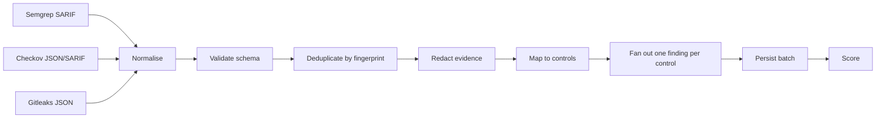

# DPDPA GitHub Code Auditor — DPDPA Rule Mapping and Scoring

| Field | Value |
|---|---|
| Document version | 1.0 |
| Date | 2026-11-04 |
| Owner | Product + Legal |
| Reviewers | DPO, external counsel, AppSec lead |
| Related documents | `PRD.md`, `database.md`, `api.md`, `security.md` |

---

## 1. Purpose

This document defines how scanner output becomes a DPDPA-mapped finding and how findings become a compliance score. It is the contract between engineering, product, and legal.

### Principles

1. **Evidence, not opinion.** The product reports what the code shows. It does not conclude that an organisation is compliant or non-compliant in law.
2. **Conservative mapping.** When a scanner rule only suggests a clause, label it `inferred` or `advisory`, not `direct`.
3. **Explain every mapping.** Each mapping carries a written rationale that a DPO can challenge.
4. **Deterministic scoring.** The same findings, rule pack, and scoring version always produce the same score.
5. **Partial coverage is visible.** A failed scanner lowers confidence; it never silently produces a clean report.
6. **Version everything.** Rule packs, mappings, and scoring are versioned, reviewed, and reproducible.

### Legal disclaimer

> The mapping is a technical aid. It is not legal advice, not a legal opinion, and not a certification of compliance. DPDPA obligations depend on facts outside the repository, including notices, consents, contracts, and processing purposes. Customers must validate findings with qualified counsel.

---

## 2. What code can and cannot evidence

| DPDPA area | Can code evidence? | How |
|---|---|---|
| Section 5 — Notice | Weakly | Presence and content of a privacy notice template, consent strings, links |
| Section 6 — Consent | Partially | Consent capture, purpose binding, withdrawal, minimisation patterns |
| Section 7 — Legitimate uses | Weakly | Documented lawful basis, employment/medical use flags |
| Section 8(4) — Security safeguards | Strongly | Encryption, access control, secrets, logging, network exposure, backups |
| Section 8(5) — Breach notification | Partially | Alerting, audit logs, detection hooks |
| Section 9 — Children's data | Partially | Age gates, verifiable parental consent, targeted-advertising flags |
| Section 10 — SDF obligations | Weakly | DPIA artifacts, audit logs, data-protection impact flags |
| Section 12 — Right to access | Weakly | Access/export endpoints |
| Section 13 — Correction and erasure | Partially | Delete/update endpoints, retention jobs, hard-delete patterns |
| Section 16 — Cross-border transfer | Partially | Region pinning, replication, third-party SDKs, data residency |

**Not assessed at MVP:** Sections 11, 14, 15 (grievance, nomination, and related procedural rights) because code provides no reliable evidence. They appear in the report as "Not assessed by code" rather than as passing controls.

---

## 3. Domain model

```
Scanner output
   │
   ▼
NormalizedFinding ──► RuleMapping ──► DpdpaControl ──► Section
   │                      │                │
   │                      └── confidence    └── weight, applicability
   ▼
ScannerFinding (persisted) ──► Scoring ──► Scan.score, section_scores, grade
```

| Entity | Purpose |
|---|---|
| `NormalizedFinding` | Scanner-agnostic finding produced by the runner |
| `DpdpaControl` | A specific, assessable obligation (`dpdpa_rules`) |
| `RuleMapping` | Joins a scanner rule to a control with confidence and rationale |
| `ScannerFinding` | Persisted, tenant-scoped instance of a mapped finding |
| `ScoreResult` | Deterministic output of the scoring function |

A single scanner finding may map to multiple controls. The engine emits one persisted finding per `(scanner finding, control)` pair, with a suffixed fingerprint.

---

## 4. Control catalog

Controls use the code format `DPDPA-<section>-<domain>-<sequence>`. Weights reflect legal significance and the reliability of code evidence.

| Code | Section | Title | Severity | Weight | Evidence strength | Scored |
|---|---|---|---|---|---|---|
| `DPDPA-5-NOTICE-01` | 5 | Privacy notice is present and linked at collection | medium | 2 | Advisory | yes |
| `DPDPA-6-CONSENT-01` | 6 | Consent is captured before personal data processing | high | 5 | Inferred | yes |
| `DPDPA-6-MIN-01` | 6 | Only necessary personal data fields are collected | high | 4 | Inferred | yes |
| `DPDPA-6-WD-01` | 6 | Consent withdrawal is implemented | medium | 3 | Inferred | yes |
| `DPDPA-7-LAWFUL-01` | 7 | A lawful basis is recorded for processing | medium | 2 | Advisory | yes |
| `DPDPA-8.4-ENC-01` | 8(4) | Personal data is encrypted at rest | high | 5 | Direct | yes |
| `DPDPA-8.4-TLS-01` | 8(4) | Personal data is encrypted in transit | high | 5 | Direct | yes |
| `DPDPA-8.4-ACCESS-01` | 8(4) | Data stores and services are not publicly exposed | critical | 8 | Direct | yes |
| `DPDPA-8.4-SECRET-01` | 8(4) | No credentials or secrets are hardcoded | critical | 8 | Direct | yes |
| `DPDPA-8.4-LOG-01` | 8(4) | Personal data is not written to logs | critical | 7 | Direct | yes |
| `DPDPA-8.4-MON-01` | 8(4) | Access and audit logging is enabled | medium | 3 | Direct | yes |
| `DPDPA-8.4-BACKUP-01` | 8(4) | Backups and versioning protect availability | medium | 2 | Direct | yes |
| `DPDPA-8.4-RET-01` | 8(4) | Retention limits are enforced in code | high | 4 | Inferred | yes |
| `DPDPA-8.5-BREACH-01` | 8(5) | Breach detection and alerting hooks exist | medium | 3 | Inferred | yes |
| `DPDPA-9-CHILD-01` | 9 | Children's data processing includes verifiable consent | high | 4 | Advisory | yes |
| `DPDPA-10-SDF-01` | 10 | SDF governance artifacts are present | low | 1 | Advisory | yes |
| `DPDPA-12-ACCESS-01` | 12 | Data access/export endpoint exists | medium | 0 | Advisory (not scored) | no |
| `DPDPA-13-ERASE-01` | 13 | Correction and erasure are implemented | high | 4 | Inferred | yes |
| `DPDPA-16-XBORDER-01` | 16 | Cross-border transfer is restricted or disclosed | high | 4 | Inferred | yes |

Weights are relative within a section, not across sections. Section weights are defined in §9.3. The `scored` column maps to `Control.scored` (§13): controls with `scored = no` are excluded from both the numerator and the denominator of every section score.

### Applicability

`dpdpa_rules.applies_when` is a JSON predicate evaluated against repository facts collected by the runner:

```json
{
  "any": [
    { "resourceType": "aws_s3_bucket" },
    { "resourceType": "aws_db_instance" },
    { "resourceType": "azurerm_storage_account" }
  ]
}
```

```json
{
  "all": [
    { "language": "python" },
    { "framework": "django" }
  ]
}
```

If a control is not applicable, it is excluded from both the numerator and the denominator. A Python-only repository is not penalised for missing Java consent checks.

---

## 5. Rule-pack format

Rule packs live in `packages/rule-packs/` and are published as immutable, signed bundles consumed by the orchestrator at startup.

```
packages/rule-packs/
├── dpdpa-controls.yaml
├── scoring.yaml
├── mappings/
│   ├── checkov.yaml
│   ├── semgrep.yaml
│   └── gitleaks.yaml
├── suppressions.yaml
└── CHANGELOG.md
```

### 5.1 Control definition

```yaml
version: 1
pack: dpdpa-2026.10.1
effectiveFrom: 2026-10-15

controls:
  - code: DPDPA-8.4-ENC-01
    section: "8(4)"
    title: Encryption of personal data at rest
    summary: >-
      Personal data stored in cloud storage or databases must be encrypted at
      rest so that disclosure of the underlying medium does not disclose the data.
    obligation: >-
      A Data Fiduciary must implement reasonable security safeguards to prevent
      a personal data breach.
    legalReference: DPDPA Section 8(4)
    severity: high
    weight: 5
    appliesWhen:
      any:
        - resourceType: aws_s3_bucket
        - resourceType: aws_db_instance
        - resourceType: azurerm_storage_account
        - resourceType: google_storage_bucket
    remediation: >-
      Enable default encryption with a customer-managed KMS key, restrict key
      administration, and verify that new buckets inherit the policy.
    tags: [encryption, storage, at-rest]
```

### 5.2 Mapping definition

```yaml
version: 1
pack: dpdpa-2026.10.1

mappings:
  - scanner: checkov
    ruleId: CKV_AWS_19
    scannerRuleVersion: "*"
    control: DPDPA-8.4-ENC-01
    confidence: direct
    rationale: >-
      CKV_AWS_19 fails when an S3 bucket has no server-side encryption
      configuration, which is direct evidence that data at rest is unencrypted.
    remediationTemplate: >-
      Set `server_side_encryption_configuration` with `sse_algorithm = "aws:kms"`
      and a customer-managed key on the bucket.

  - scanner: checkov
    ruleId: CKV_AWS_19
    scannerRuleVersion: "*"
    control: DPDPA-8.4-BACKUP-01
    confidence: advisory
    rationale: >-
      Encryption alone does not provide availability, but the same bucket
      configuration often carries versioning. This mapping is advisory and is
      shown only when versioning is also absent.
    remediationTemplate: >-
      Enable bucket versioning and lifecycle rules consistent with the retention policy.
```

### 5.3 Suppression definition

```yaml
version: 1
pack: dpdpa-2026.10.1

suppressions:
  - id: documented-test-keys
    paths:
      - "**/tests/fixtures/**"
      - "**/__fixtures__/**"
    scanners: [gitleaks]
    controls: [DPDPA-8.4-SECRET-01]
    matchHashes:
      - "sha256:4f9c...a1b2"
    reason: >-
      A specific, reviewed fixture key that is documented as fake and cannot
      authenticate. Suppression is hash-scoped, not path-wide.
    reviewedBy: security@dpdpa-auditor.example
    expiresAt: 2027-01-01
```

Suppression rules are deliberately narrow: path globs alone never suppress a secret finding. A secret is suppressed only by an exact evidence hash, a written reason, and an expiry date. Secrets in `tests/` remain findings by default.

---

## 6. Concrete mappings

> Scanner rule IDs below are examples from the pinned releases (`checkov 3.2.x`, `semgrep 1.95.x`, `gitleaks 8.21.x`). The seed manifest is the source of truth; CI verifies every ID exists in the pinned scanner version before a pack is published.

### 6.1 Checkov (IaC)

| Checkov rule | Control | Confidence | Severity | Rationale |
|---|---|---|---|---|
| `CKV_AWS_19` — S3 encryption | `DPDPA-8.4-ENC-01` | direct | high | Unencrypted object storage holding personal data |
| `CKV_AWS_145` — S3 KMS encryption | `DPDPA-8.4-ENC-01` | direct | high | Default SSE-S3 is weaker than customer-managed KMS |
| `CKV_AWS_20` — S3 public read ACL | `DPDPA-8.4-ACCESS-01` | direct | critical | Public readability of a data store |
| `CKV_AWS_18` — S3 access logging | `DPDPA-8.4-MON-01` | direct | medium | No record of access to personal data |
| `CKV_AWS_21` — S3 versioning | `DPDPA-8.4-BACKUP-01` | direct | medium | Accidental deletion or ransomware recovery |
| `CKV_AWS_16` — RDS encryption | `DPDPA-8.4-ENC-01` | direct | high | Unencrypted database storage |
| `CKV_AWS_17` — RDS public access | `DPDPA-8.4-ACCESS-01` | direct | critical | Database reachable from the internet |
| `CKV_AWS_24` — SG ingress to port 22 from `0.0.0.0/0` | `DPDPA-8.4-ACCESS-01` | direct | critical | Unrestricted administrative access |
| `CKV_AWS_25` — SG ingress to port 3389 from `0.0.0.0/0` | `DPDPA-8.4-ACCESS-01` | direct | critical | Unrestricted remote desktop access |
| `CKV_AWS_79` — EC2 IMDSv2 required | `DPDPA-8.4-ACCESS-01` | inferred | high | Credential-theft path from an application vulnerability |
| `CKV_AWS_144` — S3 cross-region replication | `DPDPA-16-XBORDER-01` | inferred | high | Personal data replicated outside the chosen region |
| `CKV_AWS_23` — Security group rule description | `DPDPA-8.4-MON-01` | advisory | low | Weak evidence; shown as hygiene, not a compliance failure |
| `CKV_K8S_*` — container runs as root / privileged | `DPDPA-8.4-ACCESS-01` | inferred | high | Container escape and lateral movement risk |

The S3 replication mapping is intentionally `inferred`: replication may be intra-region or contractually permitted. The report says "cross-region replication detected; confirm the destination region and transfer basis", not "illegal transfer".

### 6.2 Semgrep (application code)

| Semgrep rule | Control | Confidence | Severity | Rationale |
|---|---|---|---|---|
| `dpdpa.python.pii-in-logs` (custom) | `DPDPA-8.4-LOG-01` | direct | critical | A PII-shaped value is passed to a logger |
| `dpdpa.javascript.pii-in-logs` (custom) | `DPDPA-8.4-LOG-01` | direct | critical | Request body or user object logged |
| `dpdpa.generic.hardcoded-credential` (custom) | `DPDPA-8.4-SECRET-01` | direct | critical | Credential literal in source |
| `dpdpa.python.no-consent-check` (custom) | `DPDPA-6-CONSENT-01` | inferred | high | A write path touches PII without a consent dependency |
| `dpdpa.javascript.no-consent-check` (custom) | `DPDPA-6-CONSENT-01` | inferred | high | Same, for Node/Express |
| `dpdpa.generic.overcollection` (custom) | `DPDPA-6-MIN-01` | inferred | high | Schema or DTO collects fields beyond the stated purpose |
| `dpdpa.python.consent-withdrawal-missing` (custom) | `DPDPA-6-WD-01` | inferred | medium | Consent record has no withdrawal path |
| `dpdpa.generic.unbounded-retention` (custom) | `DPDPA-8.4-RET-01` | inferred | high | Rows or objects stored without a TTL or delete path |
| `dpdpa.generic.hard-delete-missing` (custom) | `DPDPA-13-ERASE-01` | inferred | high | User deletion only sets a flag |
| `dpdpa.javascript.cross-border-sdk` (custom) | `DPDPA-16-XBORDER-01` | inferred | high | A third-party SDK with a non-India default region |
| `dpdpa.generic.children-data-no-age-gate` (custom) | `DPDPA-9-CHILD-01` | advisory | high | Child-directed feature without an age gate |
| `dpdpa.generic.privacy-notice-missing` (custom) | `DPDPA-5-NOTICE-01` | advisory | medium | Collection endpoint has no notice link |

Custom rules live in `packages/rule-packs/semgrep/` and are tested against positive and negative fixtures. Semgrep registry rules may be added when their semantics directly match a control; registry IDs are pinned.

### 6.3 Gitleaks (secrets)

| Gitleaks rule | Control | Confidence | Severity | Rationale |
|---|---|---|---|---|
| `aws-access-token` | `DPDPA-8.4-SECRET-01` | direct | critical | Long-lived cloud credential in source |
| `github-pat` | `DPDPA-8.4-SECRET-01` | direct | critical | Repository access credential |
| `generic-api-key` | `DPDPA-8.4-SECRET-01` | direct | critical | Service credential |
| `private-key` | `DPDPA-8.4-SECRET-01` | direct | critical | Private key material |
| `gcp-service-account` | `DPDPA-8.4-SECRET-01` | direct | critical | Cloud service-account credential |
| `stripe-access-token` | `DPDPA-8.4-SECRET-01` | direct | critical | Payment credential |
| `slack-access-token` | `DPDPA-8.4-SECRET-01` | direct | high | Third-party access credential |
| `jwt` | `DPDPA-8.4-SECRET-01` | inferred | high | Possible session or signing secret; may be a test token |

A secret finding is direct evidence of a safeguard failure. It does not prove a breach occurred; the report language says "credential material is present in the repository", not "data was breached".

### 6.4 Cross-scanner overlap

Some issues appear in multiple scanners (for example, a hardcoded password may be caught by Semgrep and Gitleaks). The engine keeps both findings but groups them in the UI under one **evidence group** keyed by `(filePath, lineStart, controlCode)`. The score counts the control once; the table shows both sources. This avoids double-penalising the same code.

---

## 7. Normalisation pipeline



### 7.1 Normalised finding

```json
{
  "scanner": "checkov",
  "scannerRuleId": "CKV_AWS_19",
  "scannerRuleVersion": "3.2.334",
  "scannerSeverity": "high",
  "filePath": "infra/storage.tf",
  "lineStart": 14,
  "lineEnd": 28,
  "message": "S3 bucket does not have server-side encryption enabled.",
  "evidenceRedacted": "resource \"aws_s3_bucket\" \"customer_docs\" { ... }",
  "evidenceHash": "sha256:6b1f...9c02",
  "fingerprint": "fpt_7d3c...",
  "context": {
    "resourceType": "aws_s3_bucket",
    "resourceName": "customer_docs",
    "framework": "terraform",
    "language": "hcl"
  }
}
```

Rules:

- `filePath` is relative, POSIX-separated, and never escapes the repository root.
- `lineStart`/`lineEnd` must be positive and ordered; invalid values are dropped, not clamped silently.
- `message` is scanner-provided and truncated to 2,000 characters; HTML is stripped.
- `evidenceHash` is computed in the runner with a per-scan salt; the salt is discarded.
- `context` is allowlisted per scanner and never contains arbitrary key/value dumps.

### 7.2 Mapping resolution

```
resolve(scanner, ruleId, version):
  1. exact   = mappings where scanner, ruleId, scannerRuleVersion = version
  2. wildcard = mappings where scanner, ruleId, scannerRuleVersion = '*'
  3. if exact exists: use exact (do not merge with wildcard)
  4. else if wildcard exists: use wildcard
  5. else: unmapped
```

- Exact mappings win entirely; a wildcard is a fallback, not an addition.
- If multiple controls match at the same specificity, all are emitted (fan-out).
- Duplicate control codes for the same scanner finding are collapsed.
- If the scanner reports a rule ID that no longer exists in the pinned pack, the finding is stored as unmapped and a `mapping_miss` metric increments. A spike blocks the rule-pack release.

### 7.3 Severity

Persisted severity is the higher of the scanner severity and the control severity, using the order `critical > high > medium > low > info`. The original scanner severity is preserved in `context.scannerSeverity` for transparency. The report shows both when they differ.

### 7.4 Unmapped findings

- Stored with `dpdpa_rule_id = NULL`, `status = 'open'`.
- Not counted in the score.
- Displayed in a separate "Other findings" tab with an explanation.
- Included in the report appendix so nothing is hidden.
- `mapping_coverage = mapped / total` is tracked as a platform quality metric; the target is ≥ 95% for supported scanners.

---

## 8. Fingerprinting and cross-scan comparison

```
base = sha256(
  scanner + "|" +
  scannerRuleId + "|" +
  normalisedPath + "|" +
  snippetHash + "|" +
  occurrenceIndex
)
fingerprint = controlCode ? base + ":" + controlCode : base
```

- `snippetHash` hashes the normalised matched lines (trimmed, comments removed) inside the runner. The snippet itself is discarded. Unlike `evidenceHash` (§7.1), `snippetHash` is computed **without** the per-scan salt — the salt dies with the scan, while the fingerprint must stay stable across scans for the new/persistent/resolved/reopened lifecycle below.
- `occurrenceIndex` disambiguates identical matches in the same file.
- Line numbers are excluded, so a finding survives code moving down the file.
- Fan-out findings share `base` and differ by `:controlCode`.

Cross-scan status:

| Previous | Current | Label |
|---|---|---|
| absent | present | `new` |
| present | present | `persistent` |
| present | absent | `resolved` |
| resolved | present | `reopened` |

Resolution is computed at scan completion by joining on `fingerprint` within the same `repository_id`, comparing with the most recent completed scan. Renamed files produce a new fingerprint, so the report labels them `new` rather than guessing a rename.

---

## 9. Scoring model

### 9.1 Inputs

- Active findings for the scan, excluding `false_positive` and `fixed`.
- `accepted_risk` **counts as a failure** in the score but is surfaced separately, because accepting a risk does not remove the obligation.
- Applicable controls from `applies_when`.
- Control weights.
- Section weights.
- Scanner coverage.

### 9.2 Section score

```
applicableWeight(section) = Σ weight(control) for applicable controls
failedWeight(section)     = Σ weight(control) for controls with ≥1 open finding
sectionScore(section)     = 100 × (1 − failedWeight / applicableWeight)
```

If `applicableWeight = 0`, the section is **not assessed** (`null`), not 100.

Example for Section 8(4):

| Control | Weight | Failed? |
|---|---|---|
| `DPDPA-8.4-ENC-01` | 5 | yes |
| `DPDPA-8.4-TLS-01` | 5 | no |
| `DPDPA-8.4-ACCESS-01` | 8 | yes |
| `DPDPA-8.4-SECRET-01` | 8 | no |
| `DPDPA-8.4-LOG-01` | 7 | yes |
| `DPDPA-8.4-MON-01` | 3 | no |
| `DPDPA-8.4-BACKUP-01` | 2 | yes |
| `DPDPA-8.4-RET-01` | 4 | no |

`failedWeight = 5 + 8 + 7 + 2 = 22`; `applicableWeight = 42`; score = 100 × (1 − 22/42) = **47.62**.

### 9.3 Overall score

```
sectionWeights = {
  "8(4)": 30,
  "6":    20,
  "5":    10,
  "7":    10,
  "9":    10,
  "10":    5,
  "13":    5,
  "8(5)":  5,
  "16":    5
}

overall = Σ(assessedSectionScore × sectionWeight) / Σ(sectionWeight of assessed sections)
```

Sections 12, 14, and 15 have weight 0 and are reported as "Not assessed by code". If every weighted section is unassessed, `score = null` and `grade = null`.

### 9.4 Grade

| Grade | Score | Meaning |
|---|---|---|
| A | 90.00–100.00 | Strong evidence of safeguards; minor gaps |
| B | 80.00–89.99 | Good posture; address high findings |
| C | 70.00–79.99 | Material gaps; remediation plan required |
| D | 60.00–69.99 | Significant exposure; prioritise immediately |
| F | 0.00–59.99 | Critical exposure; treat as a release blocker |

### 9.5 Coverage and provisional scores

| Scanner status | Coverage |
|---|---|
| All expected scanners `completed` | Full |
| Any scanner `failed`, `timed_out`, or `skipped` | Partial |

When coverage is partial:

- `score` is still computed from available findings, labelled **Provisional**.
- `grade` is `null`; the UI shows "Grade withheld — incomplete coverage".
- The report includes a coverage banner naming the failed scanner and the reason.
- The score is **not** capped or artificially reduced; hiding missing evidence behind a penalty would be less honest than withholding the grade.

A scan with zero findings but partial coverage is explicitly **not** "clean".

### 9.6 Determinism and re-scoring

- `scoringVersion` is stored on the scan (for example `1.0.0`).
- Given the same findings, rule pack, and scoring version, the score is reproducible byte-for-byte.
- Triage changes (`false_positive`, `fixed`) trigger a recomputation of `score`, `section_scores`, `counts`, and `grade`.
- A rule-pack upgrade does **not** silently rewrite historical scores. Scans keep the pack version they ran with; a "re-score with current pack" action creates a new derived score and records both.
- The score is rounded to two decimals with half-up rounding, not banker's rounding.

### 9.7 Worked example

A repository with 3 critical, 7 high, 14 medium findings across Sections 6 and 8(4), full scanner coverage:

- Section 6: `DPDPA-6-CONSENT-01` (5) and `DPDPA-6-WD-01` (3) fail → `failedWeight = 8`, `applicableWeight = 12` → `100 × (1 − 8/12) = 33.33`
- Section 8(4): as above → `47.62`
- All other weighted sections have applicable controls and no failures → 100.
- Overall = `(33.33×20 + 47.62×30 + 100×50) / 100 = 70.95` → Grade C.

The report explains that Section 6 and 8(4) drive the grade; it does not list every control in the summary.

---

## 10. Confidence labels

| Label | Definition | UI treatment |
|---|---|---|
| `direct` | The scanner rule's semantics match the obligation with little interpretation | Green "Direct evidence" chip; counts fully |
| `inferred` | The code pattern strongly suggests the obligation is unmet, but context could change the conclusion | Amber "Inferred" chip; counts fully, with a caveat |
| `advisory` | A heuristic or hygiene signal; may not indicate a legal gap | Grey "Advisory" chip; counts only when the control is marked `scored: true` (see below) |

Advisory findings:

- Appear in the report and the findings table.
- Count toward the score **only if** the control is explicitly marked `scored: true` in the pack.
- Controls marked `scored: false` (for example `DPDPA-12-ACCESS-01`) are excluded from both the numerator and the denominator of every section score and are shown as "review recommended".
- The report never uses advisory findings to claim non-compliance.

Users can mark any finding `false_positive` with a note. That removes it from scoring for that scan only; it does not change the rule pack for other tenants.

---

## 11. Suppression and false positives

- **Triage is per finding, per scan.** Marking a false positive does not hide the same rule in future scans.
- **Rule-level suppression** is a platform decision, requires legal/security review, and ships in a rule pack with a changelog entry.
- **Path-based suppression** is limited to generated code and third-party vendored directories; it never suppresses secrets.
- **Secret suppression** requires an exact evidence hash and an expiry date.
- **Feedback loop:** every `false_positive` is aggregated weekly. A rule with a false-positive rate above 20% is reviewed for demotion (`direct` → `inferred` → `advisory`) or removal.
- **No customer-specific suppression** at MVP; the same pack applies to all tenants. Enterprise custom rules are post-MVP.

---

## 12. Versioning and legal review

### 12.1 Rule-pack lifecycle

```
DRAFT → LEGAL REVIEW → APPROVED → PUBLISHED → DEPRECATED
```

- **Draft:** engineering proposes controls and mappings with rationales and fixtures.
- **Legal review:** counsel checks the clause reference, obligation summary, and confidence label. A sample of at least 20 mappings is reviewed per release.
- **Approval:** product, legal, and security sign off in the release ticket.
- **Published:** immutable bundle with a semantic version, SHA-256, and signature.
- **Deprecated:** remains available for historical scans; new scans use the current pack.

### 12.2 Version semantics

| Change | Bump |
|---|---|
| Wording clarification, no score impact | patch |
| New control or mapping | minor |
| Weight change, section weight change, formula change | major |
| Clause reference correction | patch + legal note |

### 12.3 Customer communication

- In-app changelog for minor and major packs.
- Email to org admins for major packs, at least 14 days before default adoption.
- Historical scans are never re-scored silently.
- A "What changed" diff is available for each release.

---

## 13. Engine pseudocode

```ts
type NormalizedFinding = {
  scanner: 'semgrep' | 'checkov' | 'gitleaks'
  scannerRuleId: string
  scannerRuleVersion: string
  scannerSeverity: Severity
  filePath: string
  lineStart: number
  lineEnd: number
  message: string
  evidenceRedacted?: string
  evidenceHash: string
  fingerprint: string
  context: Record<string, unknown>
}

type Control = {
  id: string
  code: string
  section: string
  severity: Severity
  weight: number
  scored: boolean
  appliesWhen: Predicate
}

type Mapping = {
  scanner: string
  ruleId: string
  scannerRuleVersion: string
  controlCode: string
  confidence: 'direct' | 'inferred' | 'advisory'
  rationale: string
  remediationTemplate: string
}

// Repository facts collected by the runner during the scan (languages,
// frameworks, cloud resource types, IaC providers) and delivered with the
// completion callback. Applicability predicates evaluate against these.
type RepoFacts = {
  languages: string[]
  frameworks: string[]
  resourceTypes: string[]
}

function mapFinding(
  finding: NormalizedFinding,
  mappings: Mapping[],
  controls: Map<string, Control>,
): MappedFinding[] {
  const exact = mappings.filter(m =>
    m.scanner === finding.scanner &&
    m.ruleId === finding.scannerRuleId &&
    m.scannerRuleVersion === finding.scannerRuleVersion
  )
  const wildcard = mappings.filter(m =>
    m.scanner === finding.scanner &&
    m.ruleId === finding.scannerRuleId &&
    m.scannerRuleVersion === '*'
  )
  const selected = exact.length > 0 ? exact : wildcard
  if (selected.length === 0) return [{ ...finding, control: null }]

  return dedupeByControl(selected).map(m => {
    const control = controls.get(m.controlCode)!
    return {
      ...finding,
      control,
      severity: maxSeverity(finding.scannerSeverity, control.severity),
      confidence: m.confidence,
      fingerprint: `${finding.fingerprint}:${control.code}`,
      rationale: m.rationale,
      remediation: m.remediationTemplate,
    }
  })
}

function score(findings: MappedFinding[], controls: Control[], facts: RepoFacts) {
  const sections = new Map<string, { failed: number; applicable: number }>()

  for (const control of controls) {
    if (!control.scored) continue
    if (!isApplicable(control, facts)) continue
    const bucket = sections.get(control.section) ?? { failed: 0, applicable: 0 }
    bucket.applicable += control.weight
    const failed = findings.some(f =>
      f.control?.code === control.code &&
      f.status !== 'false_positive' &&
      f.status !== 'fixed'
    )
    if (failed) bucket.failed += control.weight
    sections.set(control.section, bucket)
  }

  const sectionScores: Record<string, number | null> = {}
  for (const [section, { failed, applicable }] of sections) {
    sectionScores[section] = applicable === 0
      ? null
      : round2(100 * (1 - failed / applicable))
  }

  const WEIGHTS: Record<string, number> = {
    '8(4)': 30, '6': 20, '5': 10, '7': 10, '9': 10,
    '10': 5, '13': 5, '8(5)': 5, '16': 5,
  }

  let numerator = 0
  let denominator = 0
  for (const [section, weight] of Object.entries(WEIGHTS)) {
    const score = sectionScores[section]
    if (score == null) continue
    numerator += score * weight
    denominator += weight
  }

  const overall = denominator === 0 ? null : round2(numerator / denominator)
  return { overall, sectionScores, grade: overall == null ? null : gradeFor(overall) }
}
```

The implementation lives in `apps/orchestrator/src/modules/scoring/`. It is pure: no database access, no clock, no randomness. Inputs are passed in, outputs are compared against golden fixtures in CI. `facts` is required: applicability predicates (`applies_when`, §4) evaluate against repository facts, not against the findings list, so a control with zero findings is still correctly included or excluded. `facts` arrives with the runner's completion callback (architecture.md §6.4).

---

## 14. Test fixtures

| Fixture | Purpose | Expected |
|---|---|---|
| `golden/clean-python` | No findings | Score 100, Grade A, full coverage |
| `golden/encrypted-s3` | Compliant IaC | Section 8(4) 100 |
| `golden/unencrypted-s3` | `CKV_AWS_19` fail | `DPDPA-8.4-ENC-01` finding, score drop |
| `golden/public-bucket` | `CKV_AWS_20` fail | Critical finding, Section 8(4) in F range |
| `golden/pii-logs` | Custom Semgrep hit | `DPDPA-8.4-LOG-01`, critical |
| `golden/hardcoded-key` | Gitleaks hit | `DPDPA-8.4-SECRET-01`, no raw secret returned |
| `golden/no-consent` | Inferred consent gap | `DPDPA-6-CONSENT-01`, confidence inferred |
| `golden/monorepo-mixed` | Multiple languages and IaC | Applicability filters correct |
| `golden/scanner-timeout` | One scanner times out | Partial coverage, grade null |
| `golden/unmapped-rule` | Unknown scanner rule | Unmapped bucket, score unaffected |
| `golden/false-positive` | Triage applied | Finding excluded, score recomputed |
| `golden/accepted-risk` | Triage applied | Finding still counts, badge shown |

Scoring tests are table-driven tests over `(findings, pack, scoringVersion) → { score, sectionScores, grade }` with explicit expected values — never snapshots. A changed expected value requires a `scoringVersion` bump and a legal note.

---

## 15. Limitations and honest language

- **Code is not runtime.** A repository may define an encrypted bucket and deploy an unencrypted one. The report says "as defined in code".
- **Absence of evidence is not evidence of absence.** A missing finding means the scanner did not detect the pattern, not that the risk is absent.
- **Consent cannot be proven from code.** Consent findings are `inferred`; the report asks for policy and UI evidence.
- **Data flows are approximate.** Cross-service PII flow analysis is out of scope for MVP.
- **Framework coverage is finite.** Supported: Python/Django/Flask/FastAPI, TypeScript/JavaScript/Node/Express/Next.js, Terraform, CloudFormation, Kubernetes, Dockerfile, and common language patterns. Unsupported stacks are labelled.
- **IaC coverage depends on providers.** AWS, Azure, and GCP core resources at MVP; long-tail services may be unmapped.
- **No legal conclusion.** Use "evidence of a gap", "potential exposure", and "review recommended" — never "you are in violation".

### Approved report language

| Instead of | Use |
|---|---|
| "You are DPDPA compliant" | "The repository shows evidence of these safeguards; this is not a certification" |
| "This violates Section 8" | "This finding maps to Section 8(4) and indicates a potential safeguard gap" |
| "No issues found" | "No findings were detected by the configured scanners; this is not proof of absence" |
| "Data was breached" | "Credential material was detected in the repository" |
| "Illegal cross-border transfer" | "Cross-region replication was detected; confirm the transfer basis with counsel" |
