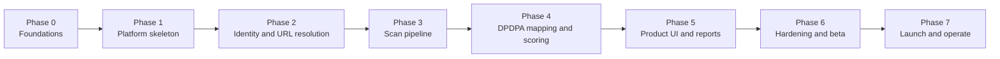

# DPDPA GitHub Code Auditor — Delivery Plan and Task Breakdown

| Field | Value |
|---|---|
| Document version | 1.0 |
| Date | 2026-11-04 |
| Status | Approved for execution |
| Owners | Engineering lead (delivery), Product (scope), Security (gates) |
| Related documents | `PRD.md`, `architecture.md`, `database.md`, `api.md`, `security.md`, `rules.md`, `design.md`, `code_style.md` |

---

## 1. How to use this document

This is the single execution plan for the MVP. It is organised into eight phases (0–7). Each phase has:

- **Outcome** — what exists at the end.
- **Entry criteria** — what must be true before work starts.
- **Tasks** — with IDs, estimates, owners, and dependencies.
- **Exit criteria** — the gate that must pass to proceed.
- **Acceptance tests** — concrete, runnable checks.

**Frontend tasks are written as planned work only.** This document specifies them; it does not implement them. Every task marked `[FE]` is a future engineering assignment, not something this documentation set produces.

### Estimation

Sizes are ideal engineering days for one senior engineer, including tests and review:

| Size | Days |
|---|---|
| XS | ≤ 0.5 |
| S | 1 |
| M | 2–3 |
| L | 4–5 |
| XL | 6–10 (must be split before starting) |

No task may remain `XL` at sprint planning. Split it.

### Status vocabulary

`todo` → `in_progress` → `in_review` → `done`. A task is `done` only when its definition of done (§10) is satisfied and the PR is merged.

---

## 2. Phase map



| Phase | Name | Duration (target) | Exit gate |
|---|---|---|---|
| 0 | Foundations | 1.5 weeks | Architecture, threat model, rule taxonomy, CI green |
| 1 | Platform skeleton | 2 weeks | Deployable web + orchestrator + Postgres + Redis |
| 2 | Identity and URL resolution | 2 weeks | Sign in, resolve + save public repo URL, API keys |
| 3 | Scan pipeline | 3 weeks | End-to-end scan on golden repos with ephemeral Jobs |
| 4 | DPDPA mapping and scoring | 2.5 weeks | Deterministic score, legal-reviewed pack v1 |
| 5 | Product UI and reports | 3 weeks | Dashboard, findings, triage, PDF export |
| 6 | Hardening and closed beta | 3 weeks | Pen test, canary test, 20 golden repos, 5 design partners |
| 7 | Launch and operate | 2 weeks + ongoing | Launch readiness review signed |

Total: ~19–20 elapsed weeks with parallel tracks. Critical path: 2 → 3 → 4 → 5 → 6.

### Parallelisation

| Track | Phases | Can start after |
|---|---|---|
| A — Platform / SRE | 0, 1, 6 infra, 7 | Day 1 |
| B — Backend / domain | 1, 2, 3, 4 | Phase 0 gate |
| C — Frontend | 1 shell, 5 | Phase 1 gate (shell), Phase 4 (feature screens) |
| D — Security / legal | 0, 4 legal review, 6, 7 | Day 1 |
| E — QA / test automation | 1 onward, continuous | Phase 1 gate |

---

## 3. Phase 0 — Foundations

**Outcome:** A repository, a working CI pipeline, agreed contracts, a threat model, and a reviewed DPDPA taxonomy. No product features.

**Entry criteria:** Team staffed; cloud account and domain available; GitHub organisation ready.

### Tasks

| ID | Task | Size | Owner | Depends on |
|---|---|---|---|---|
| P0-01 | Create monorepo with pnpm workspaces, Turborepo, `.nvmrc` (Node 22), editorconfig, gitignore | S | Platform | — |
| P0-02 | Add root TypeScript config (strict, `noUncheckedIndexedAccess`, `exactOptionalPropertyTypes`) and per-package extends | XS | Platform | P0-01 |
| P0-03 | Configure ESLint + Prettier + Tailwind class sorting; fail CI on warnings | S | Platform | P0-01 |
| P0-04 | Add Husky + lint-staged + Gitleaks pre-commit | S | Security | P0-01 |
| P0-05 | CI: install (`--frozen-lockfile`), lint, typecheck, unit, build, `pnpm audit`, Gitleaks full history | M | Platform | P0-02, P0-03, P0-04 |
| P0-06 | Create `packages/contracts` with Zod primitives: IDs, timestamps, pagination, error envelope | M | Backend | P0-02 |
| P0-07 | Create `packages/config` with shared ESLint/TS/Tailwind presets | S | Platform | P0-03 |
| P0-08 | Write ADR-001…ADR-010 (from `architecture.md`) as files under `docs/adr/` | M | Architecture | — |
| P0-09 | Threat model workshop; record STRIDE table and abuse cases | M | Security | P0-08 |
| P0-10 | DPDPA taxonomy v0: sections, candidate controls, severity, weight, evidence strength | L | Product + Legal | — |
| P0-11 | Legal review of taxonomy; sign-off memo stored in `docs/legal/` | M | Legal | P0-10 |
| P0-12 | Define the finding schema and fingerprint specification (frozen contracts) | M | Backend + Product | P0-06, P0-10 |
| P0-13 | Create golden-repo fixture scaffold: 12 directories with expected-findings manifests | L | QA | P0-12 |
| P0-14 | Error code registry in `packages/contracts` with HTTP status and retryability | S | Backend | P0-06 |
| P0-15 | Repo hygiene: CODEOWNERS, PR template, issue templates, branch protection on `main` | XS | Platform | P0-01 |
| P0-16 | Observability baseline: OpenTelemetry SDK wiring plan, log schema, PII redaction helper | M | Platform | P0-02 |
| P0-17 | Secrets inventory and manager setup; define rotation windows | M | Security | — |
| P0-18 | Data map and subprocessor list v0 (for the DPA) | M | Legal + Security | P0-09 |
| P0-19 | Define non-functional budgets as code: bundle size, API p95, scan p95 | S | Architecture | — |
| P0-20 | Create `docs/memory.md` and keep it current from this point | XS | Architecture | — |

### Exit criteria

- [ ] `main` is protected; CI runs lint, typecheck, test, build, audit, secrets on every PR.
- [ ] `packages/contracts` publishes ID, error, pagination, and finding schemas.
- [ ] ADR-001…010 merged.
- [ ] Threat model reviewed by security lead.
- [ ] DPDPA taxonomy v0 signed off by legal.
- [ ] Fingerprint specification frozen; changing it later requires a version bump.
- [ ] At least 12 golden-repo fixtures with expected-findings manifests exist.

### Acceptance tests

1. A PR with a TypeScript error fails CI.
2. A PR adding a fake AWS key fails the Gitleaks job.
3. `pnpm build` succeeds from a clean clone on Linux and macOS.
4. Importing `packages/contracts` from both `web` and `orchestrator` typechecks.
5. The golden-repo manifest schema validates all 12 fixtures.

---

## 4. Phase 1 — Platform skeleton

**Outcome:** Deployable `web` and `orchestrator` with PostgreSQL, Redis, object storage, health checks, migrations, and a local Docker Compose environment.

**Entry criteria:** Phase 0 exit gate passed.

### 4.1 Infrastructure

| ID | Task | Size | Owner | Depends on |
|---|---|---|---|---|
| P1-01 | Terraform: Kubernetes cluster, node pools (app + scanner taint), VPC, DNS | L | Platform | P0-17 |
| P1-02 | Terraform: managed PostgreSQL 16 (multi-AZ), Redis 7 (Sentinel), S3 bucket with lifecycle | L | Platform | P1-01 |
| P1-03 | Namespaces: `app`, `data`, `scanners`; resource quotas and limit ranges | M | Platform | P1-01 |
| P1-04 | NetworkPolicies: default-deny; allow web→orchestrator, orchestrator→data, runner egress allowlist | M | Platform | P1-03 |
| P1-05 | Helm charts for `web`, `orchestrator`, `renderer` with probes, HPA, PDB | L | Platform | P1-03 |
| P1-06 | Argo CD bootstrap: staging and production apps; sync policies | M | Platform | P1-05 |
| P1-07 | Secrets: External Secrets Operator or CSI driver wired to the secrets manager | M | Security | P1-01 |
| P1-08 | Local dev: Docker Compose for Postgres, Redis, MinIO, Mailpit; kind cluster for Jobs | M | Platform | P1-02 |
| P1-09 | Backup and restore: automated snapshots, PITR, quarterly restore drill scheduled | M | Platform | P1-02 |
| P1-10 | Baseline dashboards and alerts for cluster health | M | Platform | P1-05 |

### 4.2 Orchestrator foundation

| ID | Task | Size | Owner | Depends on |
|---|---|---|---|---|
| P1-11 | NestJS + Fastify bootstrap, config validation (Zod), graceful shutdown, health endpoints | M | Backend | P0-02 |
| P1-12 | Prisma schema v1 for all core tables; initial migration from `database.md` | L | Backend | P1-02 |
| P1-13 | Migration CI job (`prisma migrate deploy`) as an Argo pre-sync hook | S | Backend | P1-12 |
| P1-14 | Global exception filter mapping domain errors to the API envelope | S | Backend | P0-14 |
| P1-15 | HMAC guard for `/internal/v1` with timestamp skew and constant-time compare | M | Backend | P1-11 |
| P1-16 | Pino logger with request ID, org ID, scan ID; redaction allowlist | S | Backend | P1-11 |
| P1-17 | OpenTelemetry tracing and metrics endpoint | M | Backend | P1-11 |
| P1-18 | BullMQ module: connection, queues (`scan.execute`, `report.render`, `retention`), DLQ | M | Backend | P1-02 |
| P1-19 | Retention job skeleton (hourly, batched, idempotent) | M | Backend | P1-12, P1-18 |
| P1-20 | Testcontainers harness for Postgres and Redis | M | QA | P1-12 |
| P1-21 | Audit log service (append-only) and write-only DB role | M | Backend | P1-12 |

### 4.3 Web foundation `[FE]`

| ID | Task | Size | Owner | Depends on |
|---|---|---|---|---|
| P1-22 | Nuxt 4 app init, TypeScript strict, Nuxt UI 3, Tailwind 4 tokens from `design.md` | M | Frontend | P0-02 |
| P1-23 | `nuxt-security` configuration per `security.md` §8; verify headers with `curl` | M | Frontend + Security | P1-22 |
| P1-24 | Base layouts (`default`, `auth`, `app`, `print`), app shell, skip link | M | Frontend | P1-22 |
| P1-25 | Design-token CSS file and a token-only lint rule (no raw hex outside the file) | S | Frontend | P1-22 |
| P1-26 | `callOrchestrator` server util with HMAC signing and timeout | M | Frontend | P1-15 |
| P1-27 | Global Nitro error handler and `apiError` helper | S | Frontend | P1-26 |
| P1-28 | Health check page and status endpoint | XS | Frontend | P1-22 |
| P1-29 | `useState` org/feature context and route middleware skeleton | S | Frontend | P1-24 |
| P1-30 | Playwright harness with authenticated storage state stub | M | QA | P1-22 |

### Exit criteria

- [ ] Staging deploys `web` and `orchestrator` from `main` through Argo CD.
- [ ] Postgres and Redis are reachable only from the orchestrator namespace.
- [ ] Migrations apply cleanly to an empty database and to a database one version behind.
- [ ] `/health` returns 200 for both services; readiness fails when the DB is down.
- [ ] `curl -I` shows HSTS, CSP with nonce, and the remaining headers from `security.md`.
- [ ] Local Compose + kind brings the stack up with one documented command.
- [ ] Backup restore drill completed once.

### Acceptance tests

1. Deleting the orchestrator pod causes no failed requests beyond a 30 s window (PDB and probes work).
2. A request to `/internal/v1/health` without HMAC returns 401.
3. A request with a 10-minute-old timestamp returns 401.
4. `EXPLAIN` on the dashboard query uses `idx_scans_org_created`.
5. RLS test: a query without `SET LOCAL app.current_org` returns zero rows for the runtime role.
6. The retention job deletes an expired scan and its findings but leaves audit rows.

---

## 5. Phase 2 — Identity and URL resolution

**Outcome:** Users sign in, save public repository URLs, and the platform resolves and validates them anonymously. No scanning yet.

**Entry criteria:** Phase 1 exit gate passed.

### Tasks

| ID | Task | Size | Owner | Depends on |
|---|---|---|---|---|
| P2-01 | _Retired — GitHub App registration is post-MVP (ADR-011)._ | — | — | — |
| P2-02 | _Retired — App private key handling is post-MVP (ADR-011)._ | — | — | — |
| P2-03 | OAuth flow with PKCE and signed `state`; scope `read:user user:email` only (identity only; GitHub OAuth App registration is the only GitHub config) | M | Backend | P1-01 |
| P2-04 | Session management with `nuxt-auth-utils`: sealed cookie, 8 h absolute, 30 min idle | M | Frontend | P2-03, P1-22 |
| P2-05 | `users`, `organizations`, `memberships` repositories and services | M | Backend | P1-12 |
| P2-06 | Onboarding: create org, invite members, role assignment | M | Backend | P2-05 |
| P2-07 | _Retired — installation callback is post-MVP (ADR-011)._ | — | — | — |
| P2-08 | _Retired — installation token service is post-MVP (ADR-011)._ | — | — | — |
| P2-09 | Repository resolve: exact URL validation, `github.com` host allowlist, anonymous `git ls-remote` lookup (default branch + size-cap probe), DB upsert | M | Backend | P2-05 |
| P2-10 | _Retired — webhook endpoint is post-MVP (ADR-011)._ | — | — | — |
| P2-11 | _Retired — webhook handlers are post-MVP (ADR-011)._ | — | — | — |
| P2-12 | Repository list/detail/disconnect services with soft delete and retention scheduling | M | Backend | P2-09 |
| P2-13 | API key create/list/revoke with hashed storage and scopes | M | Backend | P2-05 |
| P2-14 | Auth middleware for API keys with 30 s cache and immediate revocation path | M | Backend | P2-13 |
| P2-15 | Login, onboarding, and repository list pages `[FE]` | L | Frontend | P2-04, P2-09 |
| P2-16 | Paste-URL repository dialog with resolve preview (default branch, size, visibility) `[FE]` | M | Frontend | P2-15 |
| P2-17 | Rate-limit middleware backed by Redis for auth, repo, and resolve routes | M | Backend | P1-18 |
| P2-18 | Audit events for login, org create, member invite, repo connect/disconnect, key create/revoke | S | Backend | P1-21 |
| P2-19 | Integration tests: OAuth callback, URL validation/allowlist, `ls-remote` probe, resolve rate limit | L | QA | P2-16 |
| P2-20 | Security tests: URL SSRF cases, tenant scoping on repos, API key scope enforcement, existence-oracle probes | M | Security | P2-12 |

Retired IDs stay reserved: P2-01, P2-02, P2-07, P2-08, P2-10, P2-11, and the old P2-16 install UI are post-MVP with the GitHub App (ADR-011).

### Exit criteria

- [ ] A new user signs in, creates an org, and saves a resolved public repository URL in under three minutes in staging — no GitHub App install anywhere in the flow.
- [ ] A private and a nonexistent repository return the identical non-leaking error (no existence oracle).
- [ ] Non-`github.com` and non-HTTPS URLs are rejected with `422 VALIDATION_ERROR`.
- [ ] Cross-tenant repository access returns 404.

### Acceptance tests

1. `POST /api/v1/repos` with `https://gitlab.com/a/b` returns `422 VALIDATION_ERROR`.
2. `POST /api/v1/repos` with `https://github.com/a/b?x=1` returns `422`.
3. `POST /api/v1/repos/resolve` with a private and with a nonexistent repository returns the same `403`/`404` pair with no metadata leakage.
4. `POST /api/v1/repos/resolve` above 30/minute per user returns `429 RATE_LIMITED`.
5. An API key without `scan:write` cannot create a scan (`403 FORBIDDEN`).
6. A revoked API key fails within 30 seconds.

---

## 6. Phase 3 — Scan pipeline

**Outcome:** A repository can be scanned end to end in an ephemeral Kubernetes Job, with normalised findings persisted and zero source retention.

**Entry criteria:** Phase 2 exit gate passed; scanner node pool and gVisor runtime class available.

### 6.1 Runner image and scanners

| ID | Task | Size | Owner | Depends on |
|---|---|---|---|---|
| P3-01 `[PY]` | Build `scan-runner` image: Git, Semgrep 1.95.x, Checkov 3.2.x, Gitleaks 8.21.x, Python 3.12 | L | Platform | P1-03 |
| P3-02 `[PY]` | Entrypoint: env validation, workspace setup, stage sequencing, structured logs | L | Backend | P3-01 |
| P3-03 `[PY]` | Safe clone: `--depth 1 --single-branch`, no submodules, timeout, size pre-check, symlink escape guard | M | Backend | P3-02 |
| P3-04 `[PY]` | Canonical Semgrep config (custom DPDPA rules + pinned registry packs), ignore repo configs | M | Security | P3-01 |
| P3-05 `[PY]` | Semgrep adapter → normalised findings; duration, exit code, timeout handling | M | Backend | P3-04 |
| P3-06 `[PY]` | Checkov adapter → normalised findings; framework detection; timeout handling | M | Backend | P3-01 |
| P3-07 `[PY]` | Gitleaks adapter → normalised findings; redaction at source; hash + masked prefix only | M | Security | P3-01 |
| P3-08 `[PY]` | Fingerprint implementation per `rules.md` §8 with per-scan salt; salt discarded after use | M | Backend | P0-12 |
| P3-09 `[PY]` | Batched callback client with HMAC, ≤ 500 findings or 1 MB, idempotent `batchId` | M | Backend | P3-02 |
| P3-10 `[PY]` | Final completion callback with scanner statuses and counts | S | Backend | P3-09 |
| P3-11 `[PY]` | Graceful `SIGTERM` handling with 30 s drain; workspace cleanup on all exit paths | S | Backend | P3-02 |
| P3-12 `[PY]` | Image hardening: distroless/Chainguard base, non-root UID 10001, digest pin, cosign sign, SBOM | M | Security | P3-01 |
| P3-13 `[PY]` | Scanner version parity check: adapter assumes the pinned version; CI fails on drift | S | QA | P3-05, P3-06, P3-07 |

`[PY]` tasks are implemented and tested in Python 3.12 (pytest, Ruff, `mypy --strict` — code_style.md §13). P3-14 onward are TypeScript in the orchestrator.

### 6.2 Orchestration

| ID | Task | Size | Owner | Depends on |
|---|---|---|---|---|
| P3-14 | Scan creation service: idempotency key, one-active-scan-per-ref rule, plan limits | M | Backend | P1-12, P2-12 |
| P3-15 | Kubernetes Job creation with Secret ordering, owner references, cleanup on failure | L | Backend | P1-03, P3-14 |
| P3-16 | Job watcher: conditions, OOM, deadline exceeded, missing callback handling | M | Backend | P3-15 |
| P3-17 | Findings callback endpoint: validation, batch idempotency, transaction insert | M | Backend | P3-09 |
| P3-18 | Completion endpoint: coverage compute, status transition to `mapping` | M | Backend | P3-10 |
| P3-19 | Cancel flow: delete Job and Secret, reject late callbacks, `SIGTERM` path | M | Backend | P3-15 |
| P3-20 | Scan events written for each lifecycle stage | S | Backend | P3-14 |
| P3-21 | Queue processor with 3 attempts, exponential backoff, DLQ and alert | M | Backend | P1-18, P3-15 |
| P3-22 | Scan status and events API (`GET /api/v1/scan/:id`, `/events`) | M | Backend | P3-14 |
| P3-23 | Cancellation API | S | Backend | P3-19 |
| P3-24 | Observability: spans from enqueue → Job → callback; metrics for duration, coverage, failures | M | Platform | P3-15 |
| P3-25 | Cost guardrail: per-scan CPU/GiB accounting to `usage_events` | M | Backend | P3-18 |

### 6.3 Frontend `[FE]`

| ID | Task | Size | Owner | Depends on |
|---|---|---|---|---|
| P3-26 | `ScanSubmitForm` with repo picker, ref selection, profile, idempotency key | L | Frontend | P3-22 |
| P3-27 | `ScanProgress` component with stage model, per-scanner status, partial warning | M | Frontend | P3-22 |
| P3-28 | `useScanPolling` composable with backoff, visibility pause, terminal stop | M | Frontend | P3-22 |
| P3-29 | Scan timeline component fed by `/events` | S | Frontend | P3-22 |
| P3-30 | Scan list page with filters and pagination | M | Frontend | P3-22 |

### Exit criteria

- [ ] A 100 MB repository scans end to end in staging in under 10 minutes at p95.
- [ ] Every scan runs in its own Job with gVisor, non-root, read-only rootfs, no SA token.
- [ ] Job and Secret are deleted within 5 minutes of completion.
- [ ] Canary retention test passes for Postgres, Redis, S3, logs, and traces.
- [ ] A scanner timeout produces `partial` coverage and never a clean report.
- [ ] Cancellation terminates the pod within 30 seconds.
- [ ] The same `Idempotency-Key` returns the same scan.

### Acceptance tests

1. Submit a scan twice with the same idempotency key → one Job, one scan, `Idempotent-Replayed: true`.
2. Submit a scan for a repo with an active scan on the same ref → `409 SCAN_IN_PROGRESS`.
3. Kill the runner mid-scan → scan ends `failed` with `INCOMPLETE_RESULTS`; no partial score is shown as final.
4. Seed a canary → it appears in none of Postgres, Redis, S3, logs, or traces.
5. Submit a repo with an outbound submodule URL → no connection attempt is made.
6. A 6 GiB workspace cap is enforced; exceeding it fails with `REPO_TOO_LARGE`.
7. Scanner exit codes map correctly to `completed`, `failed`, `timed_out`.

---

## 7. Phase 4 — DPDPA mapping and scoring

**Outcome:** Findings map to DPDPA controls and produce a deterministic, explainable score with legal-reviewed rule pack v1.

**Entry criteria:** Phase 3 exit gate passed; taxonomy v0 approved (P0-11).

### Tasks

| ID | Task | Size | Owner | Depends on |
|---|---|---|---|---|
| P4-01 | Rule-pack schema (Zod) for controls, mappings, suppressions, scoring config | M | Backend | P0-06 |
| P4-02 | Rule-pack loader with signature and SHA-256 verification; fail closed | M | Backend | P4-01 |
| P4-03 | Seed all controls from `rules.md` §4 into `dpdpa_rules` with weights and applicability | L | Product | P4-01 |
| P4-04 | Mapping resolver: exact vs. wildcard precedence, fan-out, dedupe by control | M | Backend | P4-02 |
| P4-05 | Applicability engine evaluating `applies_when` against repository facts | M | Backend | P4-03 |
| P4-06 | Mapping persistence: one finding per `(scanner finding, control)` with suffixed fingerprint | M | Backend | P4-04 |
| P4-07 | Severity reconciliation (max of scanner and control) with original preserved in context | S | Backend | P4-06 |
| P4-08 | Scoring engine (pure): section scores, overall, grade, partial coverage behaviour | L | Backend | P4-04, P4-05 |
| P4-09 | Recompute on triage: `false_positive`, `fixed`, `accepted_risk` semantics | M | Backend | P4-08 |
| P4-10 | Persist `rule_pack_version`, `scoring_version`, `section_scores`, `counts`, `coverage` | S | Backend | P4-08 |
| P4-11 | Cross-scan comparison: new / persistent / resolved / reopened by fingerprint | M | Backend | P4-06 |
| P4-12 | Golden scoring fixtures with explicit expected values (no snapshots for logic) | L | QA | P4-08 |
| P4-13 | Mapping-miss metric and CI guard: unknown scanner rule IDs in a pack fail the build | M | QA | P4-04 |
| P4-14 | Rule pack v1 authored with rationale for every mapping | L | Product | P4-03 |
| P4-15 | Legal review of ≥ 20 mappings per release; sign-off recorded in the release ticket | M | Legal | P4-14 |
| P4-16 | Rule API: list controls, control detail with mappings and remediation | M | Backend | P4-03 |
| P4-17 | Findings API: filters, sorting, pagination, redacted evidence | L | Backend | P4-06 |
| P4-18 | Triage API with note requirements and transactional audit + remediation log | M | Backend | P4-09 |
| P4-19 | Suppression semantics: hash-scoped for secrets, path-limited otherwise, expiry enforced | M | Security | P4-02 |
| P4-20 | Report view-model builder shared by dashboard and PDF | M | Backend | P4-08 |
| P4-21 | Findings workbench `[FE]`: table, filters in URL, drawer, triage form | L | Frontend | P4-17, P4-18 |
| P4-22 | Scorecard `[FE]`: score, grade, coverage banner, section breakdown, trend | L | Frontend | P4-10 |
| P4-23 | Rule explorer `[FE]` | M | Frontend | P4-16 |
| P4-24 | Rescore action that creates a derived score without rewriting history | M | Backend | P4-10 |

### Exit criteria

- [ ] The same inputs produce byte-identical scores across runs and machines.
- [ ] Section 8(4) worked example in `rules.md` §9.2 matches the engine exactly (47.62).
- [ ] Partial coverage withholds the grade and shows a banner.
- [ ] `accepted_risk` still counts toward the score and is labelled.
- [ ] Advisory controls are excluded from the score by default.
- [ ] A rule-pack upgrade does not rewrite historical scores.
- [ ] Legal sign-off recorded for pack v1.

### Acceptance tests

1. `golden/unencrypted-s3` → `DPDPA-8.4-ENC-01` finding; section 8(4) score matches the fixture.
2. `golden/public-bucket` → critical finding; overall grade in the F range as defined by the fixture.
3. `golden/scanner-timeout` → score present, grade `null`, coverage banner in the API payload.
4. `golden/false-positive` → finding excluded, score recomputed, audit row written.
5. `golden/accepted-risk` → finding still counted, badge exposed in the API.
6. `golden/unmapped-rule` → stored with null control, excluded from score, listed in "Other findings".
7. `golden/monorepo-mixed` → inapplicable controls excluded from both numerator and denominator.
8. Two scans of the same commit produce identical `section_scores` and `score`.

---

## 8. Phase 5 — Product UI and reports

**Outcome:** The complete product surface a customer uses: dashboard, scans, findings, rules, settings, audit, and PDF export.

**Entry criteria:** Phase 4 exit gate passed for the API. Frontend tasks may start earlier against mocks, but must integrate before the gate.

> **Execution boundary:** Phase 5 is specified here and implemented by the frontend team. Producing this documentation does not scaffold or implement any of it.

### 8.1 Application screens `[FE]`

| ID | Task | Size | Owner | Depends on |
|---|---|---|---|---|
| P5-01 | Overview dashboard: latest score, trend, top sections, recent scans, usage meter | L | Frontend | P4-22 |
| P5-02 | Repository list and detail with scan history and trend | M | Frontend | P4-17 |
| P5-03 | Scan list with filters, status, grade | M | Frontend | P4-17 |
| P5-04 | Scan detail page composing scorecard, coverage, findings summary, timeline | L | Frontend | P4-22 |
| P5-05 | Findings workbench: server-side pagination/sort, URL filters, bulk selection | L | Frontend | P4-21 |
| P5-06 | Finding drawer: evidence, rationale, remediation, history, triage | L | Frontend | P4-21 |
| P5-07 | Rules catalog and control detail | M | Frontend | P4-23 |
| P5-08 | Settings: org profile, retention, members and roles | M | Frontend | P2-06 |
| P5-09 | Settings: repositories (saved URLs), API keys | M | Frontend | P2-13 |
| P5-10 | Settings: billing and usage (read-only plan display at MVP) | M | Frontend | P2-05 |
| P5-11 | Audit log viewer with filters and JSON export | M | Frontend | P1-21 |
| P5-12 | Command palette (`⌘K`) for navigation and repo search | M | Frontend | P5-01 |
| P5-13 | All five states (loading, empty, error, partial, permission) for every data surface | L | Frontend | P5-01…P5-11 |
| P5-14 | Accessibility pass: axe zero serious/critical, keyboard walkthrough, screen-reader spot check | L | Frontend + QA | P5-13 |
| P5-15 | Responsive pass at 320/768/1024/1440 px | M | Frontend | P5-13 |
| P5-16 | Bundle budget verification and regression gate in CI | M | Frontend | P5-01 |

### 8.2 Reports

| ID | Task | Size | Owner | Depends on |
|---|---|---|---|---|
| P5-17 | Renderer service: Fastify + Puppeteer, queue consumer, local templates only | L | Backend | P4-20 |
| P5-18 | PDF template v1: cover, executive summary, score breakdown, top findings, remediation, methodology, appendix | L | Frontend + Product | P5-17 |
| P5-19 | S3 upload with SHA-256, `storage_key`, `size_bytes`, `expires_at` | M | Backend | P5-17 |
| P5-20 | Report request/status/download APIs with signed 15-minute URLs | M | Backend | P5-19 |
| P5-21 | `ReportDownloadButton` and status polling `[FE]` | S | Frontend | P5-20 |
| P5-22 | HTML report preview route (`/report/[reportId]`) as the accessible format | M | Frontend | P4-20 |
| P5-23 | PDF parity test: rendered numbers equal API numbers for the same scan | M | QA | P5-18 |
| P5-24 | Report expiry job and S3 lifecycle rule | S | Backend | P5-19 |
| P5-25 | Audit event for report download | XS | Backend | P5-20 |

### 8.3 Notifications and metering

| ID | Task | Size | Owner | Depends on |
|---|---|---|---|---|
| P5-26 | Transactional email: invite, scan completed, scan failed | M | Backend | P2-06 |
| P5-27 | Outbound customer webhooks for scan completion (Growth+) — post-MVP backlog | M | Backend | P3-18 |
| P5-28 | Usage metering reconciliation: scans, reports, storage byte-hours | M | Backend | P3-25 |
| P5-29 | Plan limit enforcement: scans/month, seats, retention days, concurrency | M | Backend | P5-28 |
| P5-30 | Notification preferences in org settings | S | Frontend | P5-08 |

### Exit criteria

- [ ] Every route in `design.md` §2 exists and enforces the documented role.
- [ ] Every data surface implements loading, empty, error, partial, and permission states.
- [ ] axe reports zero serious or critical issues on dashboard, findings, and report pages.
- [ ] Keyboard-only path: sign in → connect repo → scan → triage → export PDF.
- [ ] PDF p95 under 10 seconds for a 500-finding scan; numbers match the dashboard.
- [ ] Signed URL expires within 15 minutes; the S3 key is never returned to the browser.
- [ ] Bundle for `/app` is under 180 KB gzipped.
- [ ] No raw hex values outside `main.css`; no server data in Pinia.

### Acceptance tests

1. Viewer cannot start a scan from the UI, and a direct API call returns 403.
2. Filters survive reload and are shareable via URL.
3. Opening a finding drawer moves focus in and returns it on close.
4. Secret findings show "Value withheld" and no raw value anywhere in the DOM or PDF.
5. A partial-coverage scan never displays a "clean" or celebratory state.
6. PDF generated from a completed scan matches the API score to two decimals.
7. Exporting the audit log returns JSON with no tokens or code.

---

## 9. Phase 6 — Hardening and closed beta

**Outcome:** A security-reviewed product with 20 golden repos passing, 5 design partners onboarded, and operational readiness proven.

**Entry criteria:** Phase 5 exit gate passed; staging stable for one week.

### Tasks

| ID | Task | Size | Owner | Depends on |
|---|---|---|---|---|
| P6-01 | Full cross-tenant test suite: every read and write endpoint with a foreign org ID | L | Security | P5-05 |
| P6-02 | SSRF test suite: URL variants, redirects, DNS rebinding, private ranges | M | Security | P2-09 |
| P6-03 | Rate-limit and quota tests under load; verify 429 and `Retry-After` | M | Security | P2-17 |
| P6-04 | Canary retention test automated in CI on every release, signed artifact | M | Security | P3-07 |
| P6-05 | DAST (OWASP ZAP) baseline + authenticated scan; triage all findings | L | Security | P5-13 |
| P6-06 | External penetration test; remediate critical/high or formally accept with a date | XL | Security | P6-05 |
| P6-07 | Load test: 50 concurrent scans, 10 scans/min peak, polling clients | L | QA | P3-21 |
| P6-08 | Chaos: Redis down, Postgres failover, GitHub 429, pod OOM, callback loss | L | Platform | P3-16 |
| P6-09 | Backup restore drill within RTO 4 h / RPO 15 min; record evidence | M | Platform | P1-09 |
| P6-10 | Dependency and image audit; SBOM diff; cosign verification in admission | M | Security | P3-12 |
| P6-11 | Observability review: every alert has a runbook; SLO dashboards live | M | Platform | P1-10 |
| P6-12 | Incident response tabletop exercise; runbook updated | M | Security | P0-09 |
| P6-13 | Docs: customer quickstart, CI integration, API reference, security package, DPA, privacy notice | L | Product + Legal | P5-20 |
| P6-14 | Status page and `security@` contact live | S | Platform | — |
| P6-15 | 20 golden repos scanned in staging; all expected findings matched, no false criticals | L | QA | P4-12 |
| P6-16 | 5 design partners onboarded; feedback triaged; P0 bugs fixed | L | Product | P6-15 |
| P6-17 | Performance: API p95 < 400 ms; scan p95 < 10 min; PDF p95 < 10 s | M | QA | P6-07 |
| P6-18 | False-positive review: sample 100 findings; rate below 15% | M | Product + Legal | P6-15 |
| P6-19 | Legal copy review of all UI and PDF language against `rules.md` §15 | M | Legal | P5-18 |
| P6-20 | Runbooks: scan failure, GitHub outage, DB failover, report renderer, retention violation | M | Platform | P6-11 |

### Exit criteria

- [ ] Pen test complete; no open critical/high, or accepted with owner and date.
- [ ] Canary retention test green on the release candidate.
- [ ] Cross-tenant suite green for every endpoint.
- [ ] 50 concurrent scans sustained with p95 under 10 minutes.
- [ ] 20 golden repos produce expected results; false-positive rate under 15%.
- [ ] 5 design partners have completed at least one scan and one PDF export.
- [ ] All alerts have runbooks; on-call rotation active.
- [ ] DPA, privacy notice, subprocessor list, and security package published.

### Acceptance tests

1. Foreign org ID on every `GET` returns 404; on every `POST`/`PATCH` returns 404 or 403 without side effects.
2. Redis outage: scan submissions return 503 with `Retry-After`; reads still work.
3. Postgres failover: no data loss beyond RPO; orchestrator reconnects without a restart.
4. GitHub 429: scan remains queued up to 10 minutes, then fails with a clear code.
5. OOM runner: one retry with a larger class if allowed, then a visible failure.
6. Lost callback: Job success without callback produces `INCOMPLETE_RESULTS`, never a clean score.
7. Load test at 3× launch volume with no error-rate increase.

---

## 10. Phase 7 — Launch and operate

**Outcome:** Public launch, monitored operation, and a defined path to Growth.

**Entry criteria:** Phase 6 exit gate passed; launch readiness review scheduled.

### 10.1 Launch

| ID | Task | Size | Owner | Depends on |
|---|---|---|---|---|
| P7-01 | Launch readiness review: product, engineering, security, legal, support sign-off | M | CTO | P6-* |
| P7-02 | Production cutover: DNS, TLS, WAF, HSTS preload submission (after stability) | M | Platform | P1-01 |
| P7-03 | Billing integration: plans, seats, usage overage, invoices | L | Backend | P5-28 |
| P7-04 | Trial and Free plan flows; quota messaging | M | Product | P7-03 |
| P7-05 | Analytics: activation, scan success, export rate, triage rate, retention funnels | M | Product | P5-01 |
| P7-06 | Support: help centre, in-app contact, SLAs by plan | M | Support | P6-13 |
| P7-07 | Marketing site: positioning, pricing, security page, docs | L | Product | P6-13 |
| P7-08 | Launch comms: changelog, blog, design-partner quotes | M | Product | P7-07 |
| P7-09 | Canary rollout: 10% for 15 minutes, then 50%, then 100%; automatic rollback on SLO burn | M | Platform | P7-02 |
| P7-10 | Launch-day war room and rollback decision log | S | Engineering | P7-09 |

### 10.2 Operate

| ID | Task | Cadence | Owner |
|---|---|---|---|
| P7-11 | SLO review and error-budget tracking | Weekly | Platform |
| P7-12 | Rule-pack review and release (legal sign-off) | Monthly | Product + Legal |
| P7-13 | False-positive triage and mapping demotion review | Weekly | Product |
| P7-14 | Dependency and image updates (Renovate) | Weekly | Security |
| P7-15 | Access review | Quarterly | Security |
| P7-16 | Backup restore drill | Quarterly | Platform |
| P7-17 | Pen test | Annual | Security |
| P7-18 | Incident tabletop | Semi-annual | Security |
| P7-19 | Cost review: cost per scan, per org; margin | Monthly | Finance + Platform |
| P7-20 | Customer advisory board and roadmap input | Monthly | Product |

### Exit criteria (launch gate)

- [ ] All Phase 6 criteria still true on the release candidate.
- [ ] Billing produces correct invoices for Free, Starter, and Growth in a sandbox.
- [ ] Support SLAs and escalation paths published.
- [ ] Status page reflects real component health.
- [ ] Canary rollout completed with no SLO breach.
- [ ] Rollback executed once in staging within 15 minutes.
- [ ] Legal has approved launch copy and the disclaimer appears on every report.

### Acceptance tests

1. A new customer completes signup → repo → scan → PDF without support intervention.
2. Plan limit exceeded returns `402 PLAN_LIMIT_EXCEEDED` with an upgrade path.
3. Killing the canary triggers automatic rollback within the burn-rate window.
4. Status page shows a degraded component during a simulated scan outage.
5. Invoice reconciliation matches `usage_events` for a test org.

---

## 11. Definition of done (per task)

A task is done when:

- [ ] Code merged to `main` through a reviewed PR.
- [ ] Unit tests cover the behaviour, including the unhappy path.
- [ ] Integration or E2E coverage where the task crosses a boundary.
- [ ] Lint, typecheck, tests, and build pass in CI.
- [ ] No new `any`, `@ts-ignore`, or disabled lint rule without a documented reason.
- [ ] Security reviewed: input validation, authorisation, logging, secrets.
- [ ] Observability added for new failure modes (log, metric, or span).
- [ ] Docs updated if a contract, rule, or behaviour changed.
- [ ] Feature flag or migration plan exists if the change is not backward compatible.
- [ ] For UI: all five states implemented and axe clean.

---

## 12. Test strategy summary

| Layer | What it proves | When | Gate |
|---|---|---|---|
| Unit | Scoring, mapping, validation, formatters | Every PR | Blocking |
| Contract | Zod schemas accept/reject; OpenAPI matches | Every PR | Blocking |
| Integration | Repositories, transactions, RLS, queues | Every PR | Blocking |
| Scanner integration | Golden repos produce expected findings | Every PR (subset), nightly (full) | Blocking on subset |
| E2E | Primary journeys in a browser | Every PR (smoke), nightly (full) | Blocking on smoke |
| Security | Cross-tenant, SSRF, canary retention, limits | Every PR (fast), every release (full) | Blocking |
| Load | Peak and 3× peak | Pre-release | Blocking at Phase 6 |
| Chaos | Dependency failure behaviour | Phase 6, then quarterly | Blocking at Phase 6 |
| Pen test | Adversarial review | Pre-launch, annual | Blocking at Phase 6 |
| Accessibility | axe, keyboard, screen reader | Every PR (axe), release (manual) | Blocking |

### Golden repository suite

Twenty fixtures, each with a manifest:

```yaml
# tests/golden-repos/unencrypted-s3/manifest.yaml
name: unencrypted-s3
languages: [hcl]
scanners: [checkov]
expectedFindings:
  - scanner: checkov
    ruleId: CKV_AWS_19
    control: DPDPA-8.4-ENC-01
    confidence: direct
    severity: high
    minCount: 1
    maxCount: 1
expectedCoverage: full
expectedSectionScores:
  "8(4)": 90.48   # computed from the pack; asserted exactly
tolerances:
  extraFindings: 0
```

Rules:

- A missing expected finding fails the run.
- An unexpected critical finding fails the run and requires a manifest update with review.
- Extra low/info findings are reported but do not fail, to absorb scanner drift.
- Score assertions use the pack version pinned in the manifest.

### Flake policy

- A flaky test is quarantined within 24 hours with an owner and a fix date.
- Quarantined tests are excluded from the gate but tracked on a dashboard.
- No test is retried into green in CI.

---

## 13. Release and rollback

### Release checklist

- [ ] All gates green on the release candidate.
- [ ] Migration is expand/contract and reversible for one release.
- [ ] Rule pack version pinned and signed.
- [ ] Scanner image digests pinned and signed.
- [ ] Changelog entry written (user-facing where relevant).
- [ ] Rollback plan documented with the exact command.
- [ ] On-call aware of the deploy window.

### Rollback procedure

1. `argocd app rollback <app> <previous-revision>` for web and orchestrator.
2. Do **not** roll back the database automatically; expand/contract migrations keep the previous version working.
3. If a rule pack is faulty, pin the previous pack version and re-run affected scans on request.
4. Verify with smoke tests and the golden subset.
5. Record the incident and add a regression test.

### Change classes

| Change | Approval | Rollout |
|---|---|---|
| Copy, docs | Engineering | Immediate |
| UI, non-scoring | Engineering | Canary |
| API additive | Engineering | Canary |
| Scoring or rule pack | Product + Legal | Canary + customer notice for major packs |
| Auth, tenancy, retention | Security + CTO | Canary + extended soak |
| Schema destructive | CTO + DBA | Separate release after backfill |

---

## 14. Risk register (delivery)

| Risk | Likelihood | Impact | Mitigation | Owner |
|---|---|---|---|---|
| Scanner drift breaks golden repos | High | Medium | Pin versions; parity check; nightly full suite | QA |
| gVisor cold-start exceeds budget | Medium | Medium | Pre-pulled images; warm node pool; measure early in Phase 3 | Platform |
| Legal review delays rule pack | Medium | High | Start taxonomy in Phase 0; review incrementally, not at the end | Product |
| Cross-tenant bug found late | Medium | Critical | Tenant-scoping tests from Phase 2; RLS in Phase 1 | Security |
| PDF parity diverges from dashboard | Medium | High | Single view model; parity test in Phase 5 | Backend |
| Team underestimates frontend | High | Medium | Frontend starts shell in Phase 1; mocks before API integration | Frontend |
| GitHub availability or abuse limits block clones | Medium | Medium | Queue + degraded-mode messaging (operations.md); anonymous clone has no API quota | Platform |
| Cost per scan exceeds margin | Medium | Medium | Usage metering from Phase 3; alarms at 80% | Platform |
| Scope creep into cloud scanning | High | High | Non-goals in `PRD.md`; change control at phase gate | Product |

---

## 15. Metrics for delivery (not product)

| Metric | Target |
|---|---|
| PR cycle time (open → merge) | < 2 business days |
| CI duration (PR) | < 15 minutes |
| Main-branch failure rate | < 5% |
| Escaped defects per phase | ≤ 2 severity-2 |
| Golden-repo pass rate | 100% at each gate |
| Canary retention failures | 0 |
| Coverage on scoring and mapping | ≥ 95% lines |

---

## 16. Post-MVP backlog (not scheduled)

Listed to protect MVP scope, not as commitments:

- GitHub App: private repositories, repository listing, webhook-triggered rescans (ADR-011).
- GitLab and Bitbucket support.
- PR comment bot and auto-fix suggestions.
- Cloud account scanning (AWS/Azure/GCP) for runtime DSPM.
- SSO/SAML and SCIM.
- Custom Semgrep rules per tenant.
- White-label reports.
- Tagged accessible PDF pipeline.
- Multi-region data residency.
- AI assistant over findings (only after accuracy and privacy review).
- Scheduled recurring scans.
- Slack and Teams notifications.
- Monorepo path-scoped scanning profiles.

---

## 17. Appendix — task ID index

| Prefix | Phase |
|---|---|
| `P0-*` | Foundations |
| `P1-*` | Platform skeleton |
| `P2-*` | GitHub integration |
| `P3-*` | Scan pipeline |
| `P4-*` | DPDPA mapping and scoring |
| `P5-*` | Product UI and reports |
| `P6-*` | Hardening and closed beta |
| `P7-*` | Launch and operate |

Tasks marked `[FE]` are frontend work. This document specifies them; it does not implement them.
